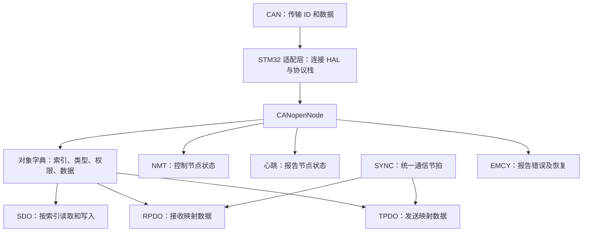

# CANopenNode 学习记录：从基础 CAN 通信到同步 PDO

> 学习区间：2026 年 10 月 11 日（星期日）00:38 起，至本次整理（2026 年 10 月 13 日）。
>
> 时区：Asia/Shanghai。这里将你说的 “Sunday 12:38 AM” 理解为星期日凌晨 00:38，而不是中午 12:38。
>
> 本文根据这段对话、你提供的 CANgaroo 截图和当前工程源码整理。对话没有每一条消息的精确时间，因此实验按实际学习顺序记录；只有 Git 提交使用仓库中可以核对的时间。
>
> 学习方式：你亲自配置、修改、编译和验证；我提供逐步指导。这次只整理文档，没有替你修改固件或发送 CAN 报文。

## 目录

- [1. 这段时间已经学会了什么](#1-这段时间已经学会了什么)
- [2. 实验环境和数字表示方法](#2-实验环境和数字表示方法)
- [3. 学习过程与 Git 里程碑](#3-学习过程与-git-里程碑)
- [4. 从普通 CAN 报文开始](#4-从普通-can-报文开始)
- [5. TIM6：建立协议栈需要的时间基础](#5-tim6建立协议栈需要的时间基础)
- [6. 把 CANopenNode 移植到本地工程](#6-把-canopennode-移植到本地工程)
- [7. 初始化、主循环和中断如何分工](#7-初始化主循环和中断如何分工)
- [8. 节点编号、Boot-up 和心跳](#8-节点编号boot-up-和心跳)
- [9. NMT：控制节点的工作状态](#9-nmt控制节点的工作状态)
- [10. 对象字典：CANopen 访问数据的入口](#10-对象字典canopen-访问数据的入口)
- [11. SDO：读取和写入对象字典](#11-sdo读取和写入对象字典)
- [12. SDO 报文进入代码后的完整流程](#12-sdo-报文进入代码后的完整流程)
- [13. RPDO：从上位机直接更新变量](#13-rpdo从上位机直接更新变量)
- [14. TPDO：节点周期上报数据](#14-tpdo节点周期上报数据)
- [15. 让 RPDO 和 TPDO 使用同一个变量](#15-让-rpdo-和-tpdo-使用同一个变量)
- [16. PDO 的初始化和运行流程](#16-pdo-的初始化和运行流程)
- [17. SYNC 实验一：同步 TPDO](#17-sync-实验一同步-tpdo)
- [18. SYNC 实验二：同步 RPDO](#18-sync-实验二同步-rpdo)
- [19. EMCY：解释遇到的 0x081 报文](#19-emcy解释遇到的-0x081-报文)
- [20. SYNC 实验三：TPDO 每两次同步发送一次](#20-sync-实验三tpdo-每两次同步发送一次)
- [21. 默认配置、运行时配置和掉电保存](#21-默认配置运行时配置和掉电保存)
- [22. Git 提交和插件操作](#22-git-提交和插件操作)
- [23. 报文、对象索引和命令速查](#23-报文对象索引和命令速查)
- [24. 按现象排查问题](#24-按现象排查问题)
- [25. 当前源码中值得后续完善的地方](#25-当前源码中值得后续完善的地方)
- [26. 如何重做实验和复习](#26-如何重做实验和复习)
- [27. 源码阅读入口与后续学习方向](#27-源码阅读入口与后续学习方向)

## 1. 这段时间已经学会了什么

最开始，你的 STM32 工程已经能够发送普通 CAN 报文，上位机能够正常接收。现在，你已经亲自完成并确认以下实验正常：

1. 使用 USB-CAN 和 CANgaroo 验证基础 CAN 通信。
2. 配置 TIM6 产生 1 ms 中断，用 LED 验证时间基础。
3. 把 CANopenNode 协议栈和 STM32 适配层放进自己的本地工程。
4. 加入 CMake 编译，调用协议栈初始化和处理函数。
5. 观察节点的 Boot-up 报文和周期心跳。
6. 使用 NMT 切换预运行、运行和停止状态。
7. 测试复位通信和复位节点。
8. 使用 SDO 读取和修改心跳周期。
9. 找到对象字典中的索引、变量、权限和访问描述符。
10. 使用 SDO 配置 RPDO1，把接收到的数据写入业务变量。
11. 使用 SDO 配置 TPDO1，先周期上报错误寄存器，再上报业务变量。
12. 在启动代码里固定 PDO 通信参数和映射。
13. 理解 CAN 接收中断、主循环和定时器中断各自处理什么。
14. 使用 SYNC 触发 TPDO。
15. 使用 SYNC 控制 RPDO 数据何时写入对象字典。
16. 识别 EMCY 报文，理解错误恢复通知。
17. 设置 TPDO 同步分频，验证每两次 SYNC 上报一次。

你现在的核心知识结构可以画成：



学习 CANopen 时，先把每项服务的职责分清，再把它们连起来，会比直接阅读整个协议栈容易得多。

## 2. 实验环境和数字表示方法

### 2.1 当前环境

| 项目 | 本次实际使用的内容 |
|---|---|
| 操作系统 | Ubuntu |
| 上位机观察软件 | CANgaroo |
| CAN 接口 | USB-CAN，SocketCAN 接口名 `can1` |
| 命令行发送工具 | `cansend` |
| STM32 系列 | STM32G474 |
| STM32 CAN 外设 | FDCAN2 |
| 使用的帧格式 | Classical CAN，标准帧，11 位 ID |
| CAN 波特率 | 1 Mbit/s |
| 定时器 | TIM6，周期 1 ms |
| CANopen 节点编号 | 1 |
| 学习项目父目录 | `/home/c/develop/project/study-canopen` |
| 当前工程目录 | `/home/c/develop/project/study-canopen/can-bak` |

**`can1` 和 FDCAN2 不是同一个编号体系。**

- `can1` 是 Ubuntu 给 USB-CAN 网络接口起的名字。
- FDCAN2 是 STM32 芯片里的第二个 FDCAN 外设。
- Node-ID `1` 是 CANopen 网络里的节点地址。

它们恰好出现在同一套实验里，但没有“编号必须相同”的关系。

### 2.2 当前 CAN 位时序

当前 `Core/Src/fdcan.c` 中的名义位时序是：

```c
hfdcan2.Init.NominalPrescaler = 5;
hfdcan2.Init.NominalTimeSeg1 = 26;
hfdcan2.Init.NominalTimeSeg2 = 7;
```

当前 FDCAN 时钟为 170 MHz，所以：

```text
波特率 = FDCAN 时钟 / [预分频 × (1 + TimeSeg1 + TimeSeg2)]

       = 170,000,000 / [5 × (1 + 26 + 7)]
       = 1,000,000 bit/s
```

其中 `1` 是同步段。`NominalSyncJumpWidth` 用于同步调整，不作为额外的位时间段加到这个公式里。

虽然外设名叫 FDCAN，这次使用的仍是传统 CAN 帧。当前配置：

```c
hfdcan2.Init.FrameFormat = FDCAN_FRAME_CLASSIC;
```

发送适配层也使用：

```c
tx_hdr.IdType = FDCAN_STANDARD_ID;
tx_hdr.FDFormat = FDCAN_CLASSIC_CAN;
tx_hdr.BitRateSwitch = FDCAN_BRS_OFF;
```

本次学习的对象是传统 CANopen，不是 CANopen FD。

### 2.3 先分清十进制和十六进制

本文中：

- `0x1017` 明确表示十六进制。
- 报文 ID `601`、`581`、`701` 等，在 `cansend` 中都是十六进制。
- 报文数据 `05`、`FE`、`E8` 也都是十六进制字节。
- 代码中的 `254`、`500`、`1000`，没有前缀时是十进制。

几个经常出现的换算：

| 十六进制 | 十进制 | 在实验中的用途 |
|---|---:|---|
| `0x01` | 1 | 节点编号、同步类型 1 |
| `0x05` | 5 | 运行状态的心跳数据 |
| `0x7F` | 127 | 预运行状态的心跳数据 |
| `0xFE` | 254 | 异步 PDO 传输类型 |
| `0xF0` | 240 | 同步循环 TPDO 类型的上限 |
| `0x01F4` | 500 | 500 ms |
| `0x03E8` | 1000 | 1000 ms |
| `0x20` | 32 | 映射的位数，32 位等于 4 字节 |

### 2.4 小端序贯穿整个实验

多字节整数在 CANopen 报文里按低字节在前排列。

例如：

```text
整数：0x03E8
报文：E8 03

整数：0x12345678
报文：78 56 34 12

对象索引：0x1017
报文中的索引字段：17 10
```

小端序只改变多字节数值的字节排列，不改变单个字节内部的位顺序。

### 2.5 如何读 cansend 命令

```bash
cansend can1 201#78563412
```

拆解如下：

| 部分 | 含义 |
|---|---|
| `cansend` | 发出 CAN 报文 |
| `can1` | 使用这个 SocketCAN 接口 |
| `201` | CAN ID 为 `0x201` |
| `#` | ID 和数据的分隔符 |
| `78563412` | 四个字节：`78 56 34 12` |

这里是 4 字节，因此 DLC 为 4。

```bash
cansend can1 080#
```

这里没有数据，因此 DLC 为 0。它仍然是普通数据帧，不是远程帧。

本文的 SDO 命令都是 8 字节。命令中的补零是构成完整 SDO 报文的填充，并不意味着对象本身一定有 8 字节。

## 3. 学习过程与 Git 里程碑

### 3.1 按学习顺序记录

| 阶段 | 你做了什么 | 你确认的结果 |
|---|---|---|
| 基础 CAN | 使用 USB-CAN、CANgaroo 查看测试帧 | 可以接收到 `0x7F1` |
| 时间基础 | 配置 TIM6，使用 LED1 验证 | LED1 每秒翻转一次 |
| 本地移植 | 将协议栈和适配层加入自己的工程 | 编译通过 |
| 生成代码问题 | CubeMX 重新生成后发现 Middlewares 内的代码消失 | 改用 ThirdParty 保存手动加入的代码 |
| 心跳 | 观察 Boot-up 和周期心跳 | `701/00` 后出现周期 `701/05` |
| NMT | 切换状态，测试两种复位 | 状态变化和复位正常 |
| SDO | 读取 `0x1017`，写入新的周期 | 读到 `E8 03`，修改后心跳周期变化 |
| 代码理解 | 查找心跳索引，梳理读写处理路径 | 找到 OD 和 SDO 的连接方式 |
| RPDO | 配置通信参数与映射 | `201` 数据写入 `0x6000:00` |
| TPDO | 配置周期上报 | `181` 周期发送 |
| 双向 PDO | RPDO 和 TPDO 映射同一个变量 | 接收到的值随后由 TPDO 上报 |
| PDO 源码 | 跟踪接收、写入和发送流程 | 工作正常 |
| 同步 TPDO | TPDO 类型改为 1 | 每次 SYNC 都发送 TPDO |
| 同步 RPDO | RPDO 改成同步 | SYNC 前仍是旧值，SYNC 后更新 |
| EMCY | 分析 `081` 的恢复通知 | 理解 RPDO 长度错误已解除 |
| 同步分频 | TPDO 类型改为 2 | 每两次 SYNC 发送一次，符合预期 |

### 3.2 可以核对的 Git 提交

以下时间来自当前仓库的 Git 记录，时区为 `+08:00`：

| 时间 | 提交 | 提交主题 | 与学习的关系 |
|---|---|---|---|
| 2026-10-11 00:05:59 | `61bda93` | Initial commit | 学习区间之前的初始仓库 |
| 2026-10-11 00:17:25 | `cfd8e30` | 创建点灯工程和can通信工程 | 学习区间之前的工程基础 |
| 2026-10-11 00:54:36 | `339905c` | 主循环100ms测试标准帧 | 基础 CAN 测试阶段 |
| 2026-10-11 01:48:51 | `5f39af7` | feat(canopen): 接入协议栈并启用心跳 | 移植与心跳阶段 |
| 2026-10-11 18:24:06 | `d67760f` | feat(canopen): 配置RPDO和TPDO通信 | 双向 PDO 阶段 |

实际提交主题中部分带有插件生成的图标，上表省略图标以便阅读。

这些时间能定位代码提交，但不能用来推断每项硬件实验发生的精确分钟。

## 4. 从普通 CAN 报文开始

### 4.1 当时看到了什么

最初，你在 CANgaroo 中看到了：

```text
接口：can1
方向：RX
类型：STD
ID：0x7F1
DLC：8
数据：83 01 FF FF FF FF FF FF
```

当时主循环每 100 ms 发送一次测试帧。当前 `main.c` 中还能找到已经注释的测试代码：

```c
// Dawn_CANFD_SendMessage(
//     0x7F0 | 0x01,
//     FDCAN_STANDARD_ID,
//     (uint8_t[]){0x83, 0x01, 0xFF, 0xFF, 0xFF, 0xFF, 0xFF, 0xFF},
//     8,
//     0
// );
// HAL_Delay(100);
```

表达式 `0x7F0 | 0x01` 得到 `0x7F1`；最后一个参数 `0` 在这个 BSP 发送函数中表示使用传统 CAN 帧。

这证明了实际硬件通路可以工作，包括 STM32、CAN 收发器、总线和 USB-CAN。

但“普通 CAN 帧能收发”还不等于“CANopen 协议已经工作”。CANopen 还需要定义报文用途、节点状态、对象字典和数据访问规则。

### 4.2 CANgaroo 的 RX/TX 是谁的视角

截图中 `RX` 表示这帧被上位机接口接收。

如果 STM32 发出心跳：

```text
STM32：发送
USB-CAN / CANgaroo：接收，显示 RX
```

不能看到 `RX` 就认为 STM32 是接收方。

### 4.3 Delta 时间的含义

你使用过 Delta 时间显示。它通常显示相邻记录之间的时间差，所以：

- 连续观察同一种心跳、没有其他报文插入时，`1.000` 可以用于判断心跳周期。
- 当日志同时包含 SDO、PDO、SYNC 和心跳时，相邻两行不一定属于同一种报文。
- 此时不能把任意一行的 Delta 直接当成该 ID 的周期。

要核对周期，应比较相同 ID 的连续报文时间，或使用适当的过滤、统计视图。

## 5. TIM6：建立协议栈需要的时间基础

### 5.1 为什么先配置定时器

CANopenNode 需要周期处理工作。当前移植使用：

- 主循环处理 NMT、心跳、SDO 等。
- TIM6 的 1 ms 中断处理 SYNC、RPDO、TPDO。

协议栈里的倒计时和超时判断依赖时间差。如果定时器配置与代码声明的时间差不一致，周期和超时都可能不正确。

### 5.2 当前参数怎么计算

当前 `Core/Src/tim.c` 中：

```c
htim6.Init.Prescaler = 170 - 1;
htim6.Init.Period = 999;
```

当前 TIM6 时钟为 170 MHz：

```text
计数频率 = 170 MHz / (169 + 1)
         = 1 MHz

每个计数 = 1 µs

中断周期 = (999 + 1) × 1 µs
         = 1000 µs
         = 1 ms
```

减一的原因是硬件按照 `PSC + 1` 和 `ARR + 1` 工作。

当前中断优先级：

```c
HAL_NVIC_SetPriority(TIM6_DAC_IRQn, 1, 0);
```

FDCAN 的中断优先级在当前工程中为 0。数字更小表示更高的抢占优先级，CAN 接收可以比 TIM6 优先处理。

### 5.3 当时怎么验证

你报告 LED1 每隔 1 秒闪烁一次。

当前定时器回调位于 `Core/Src/stm32g4xx_it.c`：

```c
void HAL_TIM_PeriodElapsedCallback(TIM_HandleTypeDef *htim)
{
    if (htim->Instance == TIM6)
    {
        canopen_app_interrupt();

        static uint16_t count = 0;

        if (++count >= 1000)
        {
            count = 0;
            HAL_GPIO_TogglePin(LED1_GPIO_Port, LED1_Pin);
        }
    }
}
```

1 ms 中断累计 1000 次，就是 1 秒。

这里准确的说法是“LED 电平每秒翻转一次”。如果 LED 一秒亮、一秒灭，那么完整的亮灭周期是 2 秒。

这个 LED 是你用来验证定时器的指示灯，不自动等同于 CANopen 标准状态指示灯。适配层虽然计算红绿状态标志，但还需要应用代码把那些标志接到实际 GPIO。

### 5.4 不要重复定义回调

`HAL_TIM_PeriodElapsedCallback()` 是 HAL 的回调函数。

当前工程已经在 `stm32g4xx_it.c` 定义了它，因此不应又在 `main.c` 添加一个同名实现，否则会出现重复定义，或者导致维护时不知道真正执行的是哪份代码。

需要增加功能时，应在现有回调的对应定时器分支内加入。

## 6. 把 CANopenNode 移植到本地工程

### 6.1 你的要求

你明确要求：

> 只教我怎么做，不要替我改；协议栈代码要移植进自己的本地工程。

因此这段学习采用的是：你执行操作，我解释步骤和原理。

最初下载的上游工程位于父目录：

```text
/home/c/develop/project/study-canopen/CANopenSTM32
```

后来真正参与当前工程编译的，是复制到 `can-bak` 内部的代码。

### 6.2 两层代码各自负责什么

| 部分 | 职责 | 是否直接依赖 STM32 HAL |
|---|---|---|
| CANopenNode | CANopen 协议逻辑：NMT、SDO、PDO、SYNC、EMCY、OD 接口等 | 核心协议通过驱动接口工作 |
| CANopenNode_STM32 | 把协议栈驱动接口连接到 STM32 CAN/FDCAN、定时器和 HAL | 是 |
| App/CANopen | 当前设备的对象字典 | 数据定义与协议接口相连 |
| Core | CubeMX 生成的外设配置、主函数、中断入口 | 是 |
| Drivers/BSP | 你原有的基础 CAN 辅助代码 | 是 |

你可以把 CANopenNode 理解为“协议规则”，把 STM32 适配层理解为“让这些规则能够使用芯片外设的连接代码”。

### 6.3 为什么 Middlewares 中的代码消失了

当时先把两层代码放进了：

```text
Middlewares/
├── CANopenNode/
└── CANopenNode_STM32/
```

后来你发现 CubeMX 重新生成代码后，这一层消失了。

本次实际遇到的问题是：把手动维护的第三方代码放进了 CubeMX 管理的目录，重新生成时被清理。

后来采用的工程结构是：

```text
can-bak/
├── Core/
│   ├── Inc/
│   └── Src/
├── Drivers/
├── ThirdParty/
│   ├── CANopenNode/
│   └── CANopenNode_STM32/
├── App/
│   └── CANopen/
│       ├── OD.c
│       └── OD.h
├── cmake/
│   └── stm32cubemx/
├── CMakeLists.txt
└── test.ioc
```

这个改动的意义是给手动加入的代码独立的维护位置，避免继续放在这次生成过程会处理的 Middlewares 目录中。

需要保留在 CubeMX 生成文件里的应用代码，应写在相应的 `USER CODE BEGIN ...` / `USER CODE END ...` 区间中。

不要把“取消某个删除选项”当成所有目录都不会被覆盖的保证；本次已经通过实际经历验证了目录选择的重要性。

### 6.4 当前 CMake 如何加入协议栈

根目录 `CMakeLists.txt` 中，当前使用工程内路径：

```cmake
set(CANOPEN_DIR "${CMAKE_CURRENT_SOURCE_DIR}/ThirdParty/CANopenNode")
set(CANOPEN_STM32_DIR "${CMAKE_CURRENT_SOURCE_DIR}/ThirdParty/CANopenNode_STM32")
set(CANOPEN_APP_DIR "${CMAKE_CURRENT_SOURCE_DIR}/App/CANopen")
```

加入协议模块和适配层源码：

```cmake
file(GLOB CANOPEN_PROTOCOL_SOURCES CONFIGURE_DEPENDS
    "${CANOPEN_DIR}/301/*.c"
    "${CANOPEN_DIR}/303/*.c"
    "${CANOPEN_DIR}/305/*.c"
)

target_sources(${CMAKE_PROJECT_NAME} PRIVATE
    ${CANOPEN_PROTOCOL_SOURCES}
    "${CANOPEN_DIR}/CANopen.c"
    "${CANOPEN_DIR}/storage/CO_storage.c"

    "${CANOPEN_STM32_DIR}/CO_driver_STM32.c"
    "${CANOPEN_STM32_DIR}/CO_app_STM32.c"
    "${CANOPEN_STM32_DIR}/CO_storageBlank.c"

    "${CANOPEN_APP_DIR}/OD.c"
)

target_include_directories(${CMAKE_PROJECT_NAME} PRIVATE
    "${CANOPEN_DIR}"
    "${CANOPEN_STM32_DIR}"
    "${CANOPEN_APP_DIR}"
)
```

两类配置的区别：

- `target_sources` 让这些 `.c` 文件参与编译。
- `target_include_directories` 让编译器能够找到 `#include` 的头文件。

只复制文件，不加入编译列表，代码不会自动成为固件的一部分。

只加入头文件目录，不加入实现文件，可能在链接阶段出现找不到函数定义的问题。

### 6.5 编译成功代表什么

你已经确认移植后编译通过。

编译通过说明文件、头文件、符号等基本连接正确；之后观察心跳、测试 NMT 和 SDO，才进一步验证了运行时接入正确。

当前工程存在 `Debug` 和 `Debug-local` 预设。以后复现时可选择自己已经使用成功的配置，例如：

```bash
cmake --preset Debug-local
cmake --build --preset Debug-local
```

这些是依据当前预设写出的复现命令，不表示整理文档时重新执行了编译。

`Debug-local` 使用本机配置的 GCC 和 Make；如果工具链路径改变，应检查 `CMakeUserPresets.json`。不要在同一个已有构建目录里随意切换不同生成器。

## 7. 初始化、主循环和中断如何分工

### 7.1 main 中的连接配置

当前 `Core/Src/main.c` 中的重要部分：

```c
#include "CO_app_STM32.h"
#include "OD.h"

static CANopenNodeSTM32 canopenConfig = {0};
```

初始化外设后：

```c
MX_GPIO_Init();
MX_FDCAN2_Init();
MX_TIM6_Init();

canopenConfig.CANHandle = &hfdcan2;
canopenConfig.HWInitFunction = MX_FDCAN2_Init;
canopenConfig.timerHandle = &htim6;
canopenConfig.desiredNodeID = 1;
canopenConfig.baudrate = 1000;  /* kbit/s */

/* 当前工程在这里设置 RPDO/TPDO 启动参数，详见第 15 节。 */

int init_result = canopen_app_init(&canopenConfig);

if (init_result != 0)
{
    Error_Handler();
}
```

每个字段的意义：

| 字段 | 当前值 | 作用 |
|---|---|---|
| `CANHandle` | `&hfdcan2` | 告诉适配层使用哪个 CAN/FDCAN 外设 |
| `HWInitFunction` | `MX_FDCAN2_Init` | 让适配层需要时重新初始化 CAN 外设 |
| `timerHandle` | `&htim6` | 提供用于周期中断的定时器 |
| `desiredNodeID` | `1` | 设置期望节点编号 |
| `baudrate` | `1000` | 记录波特率，单位 kbit/s |

**当前 STM32 适配实现不会仅凭 `baudrate = 1000` 自动重新计算 HAL 位时序。**

实际位时序仍由 CubeMX 生成的 `MX_FDCAN2_Init()` 决定。适配层调用 `CO_CANinit(..., 0)` 时，也注明 STM32 波特率来自 CubeMX 配置。

另外，上面的 `init_result` 检查需要被调用函数正确返回结果。当前本地适配层尚有一个遗漏，见第 25 节。

### 7.2 你问过：适配层在哪里启动 CAN 和 TIM6

启动 TIM6 的代码位于 `CO_app_STM32.c` 的 `canopen_app_resetCommunication()` 中：

```c
HAL_TIM_Base_Start_IT(canopenNodeSTM32->timerHandle);
```

启动 CAN 的入口也是这个函数：

```c
CO_CANsetNormalMode(CO->CANmodule);
```

真正调用 HAL 的位置在 `CO_driver_STM32.c`：

```c
void CO_CANsetNormalMode(CO_CANmodule_t* CANmodule)
{
    /* 省略条件检查和句柄获取 */
    status = HAL_FDCAN_Start(periphhandle);

    if (status == HAL_OK)
    {
        CANmodule->CANnormal = true;
    }
}
```

因此接入协议栈后，不再让旧的 BSP 初始化和应用代码重复接管 CAN 启动、过滤器和定时器启动。

当前 `main.c` 里，原来的：

```c
// Dawn_CANFD_Init();
// HAL_TIM_Base_Start_IT(&htim6);
```

已经注释。

`MX_FDCAN2_Init()` 是外设配置初始化，`HAL_FDCAN_Start()` 才是让 CAN 控制器进入通信状态；这两个动作要分清。

### 7.3 协议栈初始化的大致顺序

```text
canopen_app_init()
  ├─ 保存 STM32 配置结构的引用
  ├─ CO_new()：创建 CANopen 运行对象
  ├─ 若启用存储，则初始化存储接口（当前编译关闭；Blank 实现也未接入存储）
  └─ canopen_app_resetCommunication()
       ├─ CAN 进入配置模式
       ├─ CO_CANinit()：初始化驱动连接
       ├─ CO_LSSinit()：初始化 LSS 对象
       ├─ CO_CANopenInit()：初始化 NMT、SDO、SYNC 等
       ├─ CO_CANopenInitPDO()：初始化 PDO 和映射
       ├─ 启动 TIM6 中断
       └─ CAN 进入正常模式
```

LSS 在当前源码中存在，但这段学习还没有做 LSS 设置节点编号或波特率的实验。

### 7.4 三条执行路径

| 执行位置 | 当前主要任务 |
|---|---|
| FDCAN 接收中断 | 从硬件 FIFO 取报文，匹配协议接收回调，记录收到的数据或事件 |
| 主循环 | 调用 `canopen_app_process()`，通过 `CO_process()` 处理 NMT、心跳、SDO 等 |
| TIM6 1 ms 中断 | 调用 `canopen_app_interrupt()`，按顺序处理 SYNC、RPDO、TPDO |

主循环现在是：

```c
while (1)
{
    canopen_app_process();
}
```

旧的测试发送和 `HAL_Delay(100)` 已注释。长时间阻塞主循环会拖慢主循环负责的协议处理。

适配层主循环使用 `HAL_GetTick()` 计算实际经过的毫秒，再转为微秒：

```c
uint32_t timeDifference_us = (time_current - time_old) * 1000;
reset_status = CO_process(CO, false, timeDifference_us, NULL);
```

定时器处理则假设每次调用正好间隔 1 ms：

```c
uint32_t timeDifference_us = 1000;
```

所以 TIM6 周期必须与这个假设一致。

## 8. 节点编号、Boot-up 和心跳

### 8.1 你问过：节点编号为什么是 1

因为应用代码明确设置了：

```c
canopenConfig.desiredNodeID = 1;
```

节点编号不是由 USB-CAN 的接口名决定，也不是协议栈只能使用 1。

本次使用的常规 CANopen Node-ID 范围是 1～127；同一网络中的节点编号应当唯一。NMT 报文的目标编号 0 用于广播。

换节点编号后，默认的 SDO、PDO、心跳和 EMCY ID 会随之变化；如果应用代码把 ID 写死，也要一起核对。

### 8.2 默认报文 ID 和节点编号

对节点 1：

```text
SDO 请求：0x600 + 1 = 0x601
SDO 响应：0x580 + 1 = 0x581
心跳：    0x700 + 1 = 0x701
EMCY：    0x080 + 1 = 0x081
RPDO1：   0x200 + 1 = 0x201
TPDO1：   0x180 + 1 = 0x181
```

NMT 使用 `0x000`，通过数据中的目标字节指定节点。

SYNC 当前使用 `0x080`，不加节点编号。

这些是本次使用的默认或配置值。PDO 等通信对象的 COB-ID 可以配置，不应该认为所有设备永远只能使用这些 ID。

### 8.3 Boot-up 和普通心跳使用相同 ID

你观察到：

```text
701，DLC=1，数据=00
之后：
701，DLC=1，数据=05
701，DLC=1，数据=05
……
```

其中：

- `00` 是 Boot-up，表示节点刚完成相应的通信初始化。
- `05` 是运行状态的心跳数据。
- 心跳用于告诉其他节点“我还在线，当前处于什么状态”。

Boot-up 使用相同的 `0x700 + Node-ID` ID，但它不是周期状态值 `05`。

### 8.4 为什么启动后直接是运行状态

你问过这个默认行为在哪里体现。

在 `ThirdParty/CANopenNode_STM32/CO_app_STM32.c` 中：

```c
#define NMT_CONTROL \
    CO_NMT_STARTUP_TO_OPERATIONAL \
    | CO_NMT_ERR_ON_ERR_REG \
    | CO_ERR_REG_GENERIC_ERR \
    | CO_ERR_REG_COMMUNICATION
```

`CO_NMT_STARTUP_TO_OPERATIONAL` 表示初始化完成后自动进入 Operational。

这是当前工程的选择，不是所有 CANopen 设备都必须自动进入运行状态。没有这个设置时，可以先进入预运行状态，再由 NMT 命令启动。

### 8.5 为什么心跳是 1000 ms

对象字典 `App/CANopen/OD.c` 中：

```c
.x1017_producerHeartbeatTime = 0x03E8,
```

`0x03E8 = 1000`，单位为毫秒，因此普通心跳周期是 1 秒。

`0x1017` 是心跳生产者时间。你曾写成 `0x1701`，正确索引是 **`0x1017`**。

### 8.6 为什么第一帧心跳约 500 ms 后出现

适配层另有：

```c
#define FIRST_HB_TIME 500
```

因此在你当时的默认配置下：

```text
启动 → 发 Boot-up 00
约 500 ms 后 → 第一帧普通心跳 05
再过约 1000 ms → 下一帧 05
之后保持约 1000 ms
```

你截图里第一帧普通心跳约为 `0.499` 秒，后续为 `1.000` 秒，与此一致。

首帧时间与正常心跳周期是两个参数。若把心跳周期配置得比 500 ms 更短，初始化代码会把首帧等待时间限制到更短的周期，不能一概认为首帧永远等 500 ms。

## 9. NMT：控制节点的工作状态

NMT 的全称是 Network Management，网络管理。

本次首先用它切换状态，然后测试两类复位。

### 9.1 报文格式

```text
CAN ID：000
DLC：2

字节 0：NMT 命令
字节 1：目标 Node-ID
```

例如：

```bash
cansend can1 000#8001
```

表示对节点 1 发送 `0x80` 命令，即进入预运行状态。

```bash
cansend can1 000#8000
```

目标为 0，表示广播给网络中所有节点。单节点实验优先使用目标 1，便于明确操作对象。

### 9.2 已测试的命令

| 命令字节 | 十进制 | 作用 | 节点 1 的命令 |
|---|---:|---|---|
| `01` | 1 | 进入运行状态 | `000#0101` |
| `02` | 2 | 进入停止状态 | `000#0201` |
| `80` | 128 | 进入预运行状态 | `000#8001` |
| `81` | 129 | 复位节点 | `000#8101` |
| `82` | 130 | 复位通信 | `000#8201` |

注意：心跳数据中的 `05` 是状态值，NMT 命令中的 `01` 是启动命令。它们不是同一套枚举。

### 9.3 三种常用状态

| 状态 | 心跳数据 | SDO | PDO | NMT |
|---|---|---|---|---|
| Pre-operational，预运行 | `7F` | 可用 | 不进行正常 PDO 交换 | 可用 |
| Operational，运行 | `05` | 可用 | 可用，前提是 PDO 已正确配置并启用 | 可用 |
| Stopped，停止 | `04` | 不可用 | 不可用 | 可用 |

“停止状态”不是关闭 MCU，也不是停止所有 CANopen 报文。它仍然可以接收 NMT，并继续报告心跳状态。

“运行状态”也不意味着所有 PDO 自动可用。PDO 还必须启用、映射有效、满足触发条件。

### 9.4 当时的验证方法

进入预运行：

```bash
cansend can1 000#8001
```

观察 `701` 数据变成 `7F`，并验证 SDO 仍能访问。

进入停止：

```bash
cansend can1 000#0201
```

观察 `701` 数据变成 `04`，SDO 不再按正常方式响应。

再次运行：

```bash
cansend can1 000#0101
```

观察 `701` 数据恢复 `05`。

你报告这些操作都正常。

### 9.5 复位通信和复位节点的区别

你随后询问了其他 NMT 工作设置，重点学习了：

```bash
cansend can1 000#8201
```

以及：

```bash
cansend can1 000#8101
```

**复位通信：当前适配层的行为**

```text
收到 Reset Communication
  → CO_NMT_process 返回 CO_RESET_COMM
  → 停止 TIM6 中断
  → CAN 进入配置模式
  → CO_delete 删除运行对象
  → 再次调用 canopen_app_init
  → 重建 CANopen 运行对象并重新启动通信
```

当前实现不重新执行 `main()`，也没有在这个路径里重新复制整个 OD 的初始数据。

所以这份代码中的 RAM 业务值和 SDO 修改过的通信参数，可以在通信复位时保留；协议内部状态、计数器和定时器会重新建立。

这是对**当前移植实现**的描述，不能当成所有 CANopen 设备对通信参数复位的统一保证。

**复位节点：当前适配层的行为**

```text
收到 Reset Node
  → CO_NMT_process 返回 CO_RESET_APP
  → HAL_NVIC_SystemReset()
  → STM32 重启
  → 全局数据重新初始化
  → main 重新执行
  → 应用再次设置启动 PDO 参数
```

所以通过 SDO 临时改的同步类型，在复位节点后会被当前启动代码恢复为类型 254。

复位节点也不是“擦除 Flash”或“恢复出厂设置”。

你当时写过“复位节电”，这段学习按“复位节点”理解。节电或休眠是另一个主题，不是这里的 NMT 复位命令。

### 9.6 两类复位的代码入口

- `CO_NMT_Heartbeat.c`：解析命令并产生复位请求。
- `CO_app_STM32.c`：根据 `CO_RESET_COMM` 或 `CO_RESET_APP` 执行真正的操作。
- 当前节点复位调用 `HAL_NVIC_SystemReset()`。
- 当前通信复位调用 `CO_delete()` 后重新初始化。

这也说明协议层和芯片适配层各自负责一部分：协议层决定“请求什么”，适配层决定“在芯片上怎么执行”。

## 10. 对象字典：CANopen 访问数据的入口

对象字典简称 OD，Object Dictionary。

它不是普通的“所有 C 变量列表”，而是一组给 CANopen 暴露的数据入口，包含：

- 索引和子索引。
- 数据类型与长度。
- 读写权限。
- 是否允许 PDO 映射。
- 实际数据的内存地址。
- 可选的自定义读写函数。

### 10.1 Index 和 Sub-index

用 `0x6000:00` 表示：

```text
Index：0x6000
Sub-index：0x00
```

SDO 通过这个地址找到目标数据。

`0x1800:02` 表示 TPDO1 通信参数对象中的传输类型子项。

对象索引不是 CAN ID。举例：

| 内容 | 值 |
|---|---|
| 心跳对象索引 | `0x1017` |
| 节点 1 的心跳报文 ID | `0x701` |
| 用来读取心跳对象的 SDO 请求 ID | `0x601` |
| SDO 请求数据中的索引字节 | `17 10` |

### 10.2 OD.h 和 OD.c 分别做什么

`OD.h` 主要提供：

- 类型声明。
- 对象字典变量的声明。
- 对象数量。
- 快速访问条目宏。

`OD.c` 主要提供：

- 变量初值。
- 数据访问描述符。
- 索引表。
- 最终的对象字典实例。

当前 OD 文件由 CANopenEditor 生成。学习期间为了理解 PDO 权限，你手动改过一处属性。后续正式维护时，应把对应设置同步到编辑器源文件，避免重新生成时丢失。

### 10.3 以心跳对象 0x1017 为例

实际变量在 `OD_PERSIST_COMM` 中：

```c
uint16_t x1017_producerHeartbeatTime;
```

初值：

```c
.x1017_producerHeartbeatTime = 0x03E8,
```

访问描述符：

```c
.o_1017_producerHeartbeatTime = {
    .dataOrig = &OD_PERSIST_COMM.x1017_producerHeartbeatTime,
    .attribute = ODA_SDO_RW | ODA_MB,
    .dataLength = 2
},
```

索引表：

```c
{0x1017, 0x01, ODT_VAR, &ODObjs.o_1017_producerHeartbeatTime, NULL},
```

这里第二个 `0x01` 表示条目数量，不是让你使用子索引 `01`。

`0x1017` 是一个普通变量对象，访问它使用子索引 `00`。

快捷条目宏：

```c
#define OD_ENTRY_H1017_producerHeartbeatTime &OD->list[12]
```

`list[12]` 是当前索引表中的数组位置，不是 CANopen 索引编号。

### 10.4 本次业务变量 0x6000:00

当前类型：

```c
uint32_t x6000_velocity;
```

当前数据位置：

```c
OD_RAM.x6000_velocity
```

当前访问描述符：

```c
.o_6000_velocity = {
    .dataOrig = &OD_RAM.x6000_velocity,
    .attribute = ODA_SDO_RW | ODA_RPDO | ODA_TPDO | ODA_MB,
    .dataLength = 4
}
```

各属性的含义：

| 属性 | 含义 |
|---|---|
| `ODA_SDO_RW` | 允许 SDO 读取和写入 |
| `ODA_RPDO` | 允许被 RPDO 映射并写入 |
| `ODA_TPDO` | 允许被 TPDO 映射并发送 |
| `ODA_MB` | 多字节数据，涉及字节序处理 |
| `dataLength = 4` | 对象长度为 4 字节 |

变量名带有 `velocity`，但本次实验只是把它作为一个 32 位整数验证通信。没有建立真实速度单位、比例、控制算法或运动设备行为。

## 11. SDO：读取和写入对象字典

SDO 是 Service Data Object。

在本次实验中，上位机发出请求，节点按照对象索引读取或写入，再给出成功响应或错误响应。

### 11.1 谁是客户端，谁是服务器

| 角色 | 本次由谁承担 |
|---|---|
| SDO 客户端 | 你在 Ubuntu 上用命令发出请求 |
| SDO 服务器 | STM32 上的 CANopenNode |
| 请求 ID | 节点 1 默认使用 `601` |
| 响应 ID | 节点 1 默认使用 `581` |

手工发送一帧 SDO 请求，也是在按 SDO 客户端的报文格式发起操作，不要求上位机必须使用某个专用 CANopen 软件。

### 11.2 本次使用的快速传输格式

本次数据都不超过 4 字节，因此使用 expedited transfer，快速传输：

```text
字节 0：命令字节
字节 1：索引低字节
字节 2：索引高字节
字节 3：子索引
字节 4～7：数据，或未使用的填充
```

所有多字节整数使用小端序。

### 11.3 常用命令字节

| 命令字节 | 方向 | 含义 |
|---|---|---|
| `40` | 客户端 → 服务器 | 发起读取 |
| `2F` | 客户端 → 服务器 | 快速写入 1 字节 |
| `2B` | 客户端 → 服务器 | 快速写入 2 字节 |
| `27` | 客户端 → 服务器 | 快速写入 3 字节 |
| `23` | 客户端 → 服务器 | 快速写入 4 字节 |
| `4F` | 服务器 → 客户端 | 快速读取成功，返回 1 字节 |
| `4B` | 服务器 → 客户端 | 快速读取成功，返回 2 字节 |
| `47` | 服务器 → 客户端 | 快速读取成功，返回 3 字节 |
| `43` | 服务器 → 客户端 | 快速读取成功，返回 4 字节 |
| `60` | 服务器 → 客户端 | 写入成功 |
| `80` | 任一方 → 对方 | 中止传输，后四字节携带原因 |

3 字节格式在这段学习中没有实际做实验，列出它是为了让快速传输格式完整。

超过 4 字节的数据需要分段或块传输；本次还没有学习这些过程。

### 11.4 第一次读取心跳周期

发送：

```bash
cansend can1 601#4017100000000000
```

逐字节解释：

```text
40 | 17 10 | 00 | 00 00 00 00
读 | 1017  | 子0 | 填充
```

你实际收到并确认：

```text
4B 17 10 00 E8 03 00 00
```

拆解：

| 字段 | 内容 | 含义 |
|---|---|---|
| 命令 | `4B` | 读取成功，2 字节数据 |
| 索引 | `17 10` | `0x1017` |
| 子索引 | `00` | 子索引 0 |
| 有效数据 | `E8 03` | `0x03E8 = 1000` |
| 填充 | `00 00` | 不属于这个 16 位对象的有效数据 |

所以读到的是 1000 ms。

### 11.5 写入 500 ms

发送：

```bash
cansend can1 601#2B171000F4010000
```

逐字节解释：

```text
2B | 17 10 | 00 | F4 01 | 00 00
写2字节 | 1017 | 子0 | 500 | 填充
```

预期成功响应：

```text
60 17 10 00 00 00 00 00
```

再次读取：

```bash
cansend can1 601#4017100000000000
```

预期：

```text
4B 17 10 00 F4 01 00 00
```

你验证心跳周期相应变化，读写正常。

### 11.6 如何恢复 1000 ms

```bash
cansend can1 601#2B171000E8030000
```

这是把同一个对象重新写成 `0x03E8`。

### 11.7 读写业务变量

读取 `0x6000:00`：

```bash
cansend can1 601#4000600000000000
```

若变量为 `0x12345678`，预期：

```text
581：43 00 60 00 78 56 34 12
```

写入数值 1：

```bash
cansend can1 601#2300600001000000
```

预期：

```text
581：60 00 60 00 00 00 00 00
```

SDO 访问对象字典，不受 PDO 是否等待 SYNC 的同一套触发规则控制。这一点后来用于验证同步 RPDO。

### 11.8 SDO 成功和失败怎么判断

成功写入通常看：

```text
60 + 原索引和子索引 + 填充
```

失败可能看：

```text
80 + 原索引和子索引 + 4 字节 Abort Code
```

不要只看收到了一帧 `581` 就认为成功。必须看命令字节和后续内容。

Abort Code 同样是小端序。遇到错误时，先把最后四字节还原为 32 位错误码，再去查当前源码的 `CO_SDO_abortCode_t` 定义。

另外，节点在 Stopped 状态下不会正常处理 SDO。这个时候“没有响应”不一定是报文格式错误。

## 12. SDO 报文进入代码后的完整流程

你专门问过：读取和写入时，代码收到报文之后怎么走。

下面以读取或写入 `0x1017:00` 为例。

### 12.1 第一段：CAN 中断把报文交给 SDO

```text
总线收到 ID 601
  ↓
FDCAN2_IT0_IRQHandler()
  ↓
HAL_FDCAN_IRQHandler(&hfdcan2)
  ↓
HAL_FDCAN_RxFifo0Callback()
  ↓
prv_read_can_received_msg()
  ↓
从硬件 FIFO 取出 ID、DLC、数据
  ↓
按 rxArray 中的 ID 和掩码匹配
  ↓
CO_SDO_receive()
  ↓
缓存请求，设置 CANrxNew
```

当前使用的接收函数名是 **`CO_SDO_receive()`**。

这个阶段主要完成接收和通知，不把整个 SDO 状态机全部放进 CAN 中断执行。

### 12.2 第二段：主循环解析和访问对象字典

```text
main 的 while(1)
  ↓
canopen_app_process()
  ↓
CO_process()
  ↓
CO_SDOserver_process()
  ↓
解析命令字节、index、sub-index
  ↓
OD_find() 找到对象
  ↓
OD_getSub() 取得长度、访问属性和读写接口
  ↓
检查请求是否合法
  ↓
调用对应的 read / write
```

这里需要理解两个层次：

- `OD_find()` 根据索引找到条目。
- `OD_getSub()` 根据子索引取得真正的访问接口。

如果对象不存在、子索引不存在、访问权限不符、长度不符等，SDO 可以产生中止响应。

### 12.3 普通读取

通常使用：

```c
OD_readOriginal(...)
```

它通过对象字典描述符中的 `dataOrig` 找到变量，把数据读到协议缓冲区。

例如 `0x1017` 指向：

```c
&OD_PERSIST_COMM.x1017_producerHeartbeatTime
```

当前配置下，读取过程会通过 `readFromOd()` 等内部函数搬运数据；对新手而言，先掌握“读接口最终访问 OD 中的实际变量”即可。

### 12.4 普通写入和特殊写入

普通变量常使用：

```c
OD_writeOriginal(...)
```

它把数据写入实际内存。

但 `0x1017` 具有扩展写接口：

```c
OD_write_1017(...)
```

这个函数不只更新变量，还更新 NMT 运行对象：

```c
NMT->HBproducerTime_us = (uint32_t)CO_getUint16(buf) * 1000U;
NMT->HBproducerTimer = 0;

return OD_writeOriginal(stream, buf, count, countWritten);
```

含义：

1. 把对象中的毫秒转换为运行对象使用的微秒。
2. 清零倒计时；若新周期不为 0，让下一轮处理尽快重新发送心跳并开始新的周期。若新周期为 0，则关闭周期心跳。
3. 把数值写回对象字典实际变量。

所以心跳参数可以通过 SDO 立即生效，不需要等待 MCU 重启。

### 12.5 第三段：组织响应并发回总线

```text
SDO 组织响应
  ↓
CO_CANsend()
  ↓
prv_send_can_message()
  ↓
HAL_FDCAN_AddMessageToTxFifoQ()
  ↓
总线发出 ID 581
  ↓
CANgaroo 显示收到响应
```

一次完整操作的连接关系是：

```mermaid
sequenceDiagram
    participant PC as Ubuntu 上位机
    participant IRQ as STM32 CAN 接收中断
    participant LOOP as 主循环/SDO 状态机
    participant OD as 对象字典
    PC->>IRQ: 601：SDO 请求
    IRQ->>LOOP: 缓存请求，标记新数据
    LOOP->>OD: 按索引读取或写入
    OD-->>LOOP: 返回数据或结果
    LOOP-->>PC: 581：成功响应或中止响应
```

这张图表达的是当前裸机移植的职责分工，不代表其他所有平台都必须使用同样的任务或中断安排。

## 13. RPDO：从上位机直接更新变量

RPDO 是 Receive Process Data Object，接收过程数据对象。

“接收”以 CANopen 节点的视角命名。本次上位机发送 `201`，STM32 接收并更新变量，所以对 STM32 来说它是 RPDO。

### 13.1 为什么已经有 SDO，还要 PDO

SDO 报文需要携带索引、子索引、命令，并有请求/响应。

PDO 事先配置好映射，运行时数据帧只携带业务数据，适合重复交换过程数据。

例如已经约定 `201` 的四个字节对应 `0x6000:00`：

```text
201：78 56 34 12
```

节点不用再从这帧里解析 `6000` 索引，因为初始化时已经配置好了映射。

### 13.2 你问过：默认是否没有配置 RPDO 参数

更准确的回答是：

- 通信参数对象存在。
- 映射对象也存在。
- 但原始默认状态下，RPDO 被禁用，映射数量为 0，因此没有形成可用的数据通道。

原始 `OD.c`：

```c
.x1400_RPDOCommunicationParameter = {
    .highestSub_indexSupported = 0x05,
    .COB_IDUsedByRPDO = 0x80000200,
    .transmissionType = 0xFE,
    .eventTimer = 0x0000
},

.x1600_RPDOMappingParameter = {
    .numberOfMappedApplicationObjectsInPDO = 0x00,
    .applicationObject1 = 0x00000000,
    /* 其余映射也为 0 */
},
```

所以当时需要配置它。

使用 SDO 手工配置不是唯一方法。后来你又在 `main` 初始化前设置了同样的参数；正式项目也可以使用 CANopenEditor 修改对象字典默认配置。

### 13.3 通信参数和映射参数分开

| 对象 | 用途 | 本次重要子项 |
|---|---|---|
| `0x1400` | RPDO1 通信参数 | `01` COB-ID；`02` 传输类型 |
| `0x1600` | RPDO1 映射参数 | `00` 有效映射数；`01` 第一个映射 |

通信参数回答：

> 这路 PDO 使用什么 CAN ID，怎么触发？

映射参数回答：

> 报文中的数据对应对象字典里的哪些对象？

### 13.4 理解映射值 0x60000020

一个映射项是 32 位：

```text
高 16 位：对象索引
中间 8 位：子索引
低 8 位：映射长度，单位为 bit
```

本次：

```text
0x6000 00 20
  │    │  └─ 0x20 = 32 bit = 4 字节
  │    └──── 子索引 0
  └───────── 对象索引 0x6000
```

合并：

```c
0x60000020
```

通过 SDO 写这个 32 位值时，数据区是：

```text
20 00 00 60
```

这是整个 32 位整数按小端序排列的结果。

### 13.5 第一次 RPDO 配置的完整顺序

这是当时从未启用、未映射状态开始的实验记录。当前启动代码已经完成同样的映射，因此复习时要知道自己是在重做哪一阶段。

每条 SDO 写入后，都应先确认 `581` 返回 `60` 成功，再继续下一条。

**进入预运行：**

```bash
cansend can1 000#8001
```

**禁用 RPDO1，并指定 ID 201：**

```bash
cansend can1 601#2300140101020080
```

这是写 `0x1400:01 = 0x80000201`。最高位 bit31 为 1，表示禁用。

**清空有效映射数：**

```bash
cansend can1 601#2F00160000000000
```

这是写 `0x1600:00 = 0`。

**写入第一个映射项：**

```bash
cansend can1 601#2300160120000060
```

这是写 `0x1600:01 = 0x60000020`。

**启用一个映射项：**

```bash
cansend can1 601#2F00160001000000
```

这是写 `0x1600:00 = 1`。

**设置异步传输类型：**

```bash
cansend can1 601#2F001402FE000000
```

这是写 `0x1400:02 = 254`。

**启用 RPDO1：**

```bash
cansend can1 601#2300140101020000
```

这是写 `0x1400:01 = 0x00000201`，清除 bit31。

**进入运行：**

```bash
cansend can1 000#0101
```

### 13.6 为什么先禁用，再清空映射数量

运行时修改映射会改变报文的解释方式。

这套顺序让协议栈在配置完整后再启用 PDO：

```text
禁用 PDO
  → 映射数量设为 0
  → 修改映射条目
  → 设置有效映射数量
  → 启用 PDO
```

“进入预运行”控制的是节点状态；“禁用 PDO”控制的是这路 PDO 是否有效，两者不是同一个开关。

在 `main` 中、协议栈初始化之前直接设置数据，则是另一种情况：运行对象还没有建立，可以先完整填好有效配置，再让初始化函数统一校验和创建。

### 13.7 验证 RPDO 写入

发送：

```bash
cansend can1 201#78563412
```

再读取：

```bash
cansend can1 601#4000600000000000
```

预期：

```text
581：43 00 60 00 78 56 34 12
```

说明 `OD_RAM.x6000_velocity = 0x12345678`。

你确认正常。

### 13.8 RPDO 不会返回同类确认报文

发送 `201` 后，不会像 SDO 那样必然返回一帧 `60`。

这不代表 CAN 总线没有链路层 ACK，而是说 PDO 服务没有 SDO 那样的逐次请求/响应协议。

后来出现的 `181` 是 TPDO 按自身触发规则上报，不是 RPDO 的固定确认帧。

## 14. TPDO：节点周期上报数据

TPDO 是 Transmit Process Data Object，发送过程数据对象。

它同样以节点视角命名。本次 STM32 发出 `181`，所以是 STM32 的 TPDO1。

### 14.1 第一次映射的是错误寄存器

最初没有直接让 `0x6000` 同时用于 TPDO，而是先选择已有 TPDO 权限的：

```text
0x1001:00：错误寄存器
长度：1 字节
```

它的属性是：

```c
ODA_SDO_R | ODA_TPDO
```

这样可以先验证 TPDO 的配置和周期发送，不需要同时修改业务变量权限。

### 14.2 TPDO1 的对象

| 对象 | 用途 |
|---|---|
| `0x1800` | TPDO1 通信参数 |
| `0x1A00` | TPDO1 映射参数 |

重要子项：

| 地址 | 含义 | 本次值 |
|---|---|---|
| `0x1800:01` | COB-ID | `0x40000181` |
| `0x1800:02` | 传输类型 | 254 |
| `0x1800:03` | 抑制时间 | 当前启动配置为 0 |
| `0x1800:05` | 事件定时器 | 500 ms |
| `0x1A00:00` | 有效映射数 | 1 |
| `0x1A00:01` | 映射项 | 第一轮为 `0x10010008` |

`0x10010008` 的含义是：`0x1001:00`，长度 8 bit，即 1 字节。

### 14.3 第一轮 TPDO 配置命令

先进入预运行：

```bash
cansend can1 000#8001
```

禁用 TPDO1：

```bash
cansend can1 601#23001801810100C0
```

清空映射数量：

```bash
cansend can1 601#2F001A0000000000
```

映射错误寄存器：

```bash
cansend can1 601#23001A0108000110
```

有效映射数量为 1：

```bash
cansend can1 601#2F001A0001000000
```

传输类型为 254：

```bash
cansend can1 601#2F001802FE000000
```

事件定时器为 500 ms：

```bash
cansend can1 601#2B001805F4010000
```

启用 TPDO1：

```bash
cansend can1 601#2300180181010040
```

进入运行：

```bash
cansend can1 000#0101
```

### 14.4 为什么禁用值是 C0000181，启用值是 40000181

```text
0xC0000181：bit31=1，禁用；bit30=1，保留“不允许 RTR”的设置
0x40000181：bit31=0，启用；bit30 仍为 1
```

当前使用普通数据帧，没有做远程帧触发 TPDO 的实验。

### 14.5 当时观察到的结果

正常无错误时：

```text
ID：181
DLC：1
数据：00
周期：约 500 ms
```

进入预运行后，TPDO 停止，心跳继续。

你确认工作正常。

### 14.6 254 本身不等于“每 500 ms”

`254` 指的是异步事件方式。

本次每 500 ms 发送，是因为另一个参数 `0x1800:05` 被设置为 500 ms。

要一起看：

```text
传输类型：决定采用哪种触发方式
事件定时器：在适用的模式下，提供周期触发
抑制时间：限制适用的异步发送频率
```

TPDO 的抑制时间单位是 100 µs，事件定时器单位是 ms。不要把这两个时间对象的单位混淆。

## 15. 让 RPDO 和 TPDO 使用同一个变量

这一步把独立的接收和发送实验连成完整通路：

```text
上位机发送 201
  → RPDO 更新 0x6000:00
  → TPDO 读取 0x6000:00
  → 节点发送 181
```

### 15.1 为什么要增加 TPDO 属性

原来的 `0x6000` 只允许：

```c
ODA_SDO_RW | ODA_RPDO | ODA_MB
```

允许 SDO 读写和 RPDO 写入，并不自动允许 TPDO 映射。

你把 `OD.c` 中这项改为：

```c
.attribute = ODA_SDO_RW | ODA_RPDO | ODA_TPDO | ODA_MB,
```

之后同一个对象既可以接收，也可以上报。

### 15.2 当前启动参数

在 `canopen_app_init()` 之前设置：

```c
/* RPDO1：接收 0x201，写入 0x6000:00 */
OD_PERSIST_COMM.x1400_RPDOCommunicationParameter.COB_IDUsedByRPDO =
    0x00000201;

OD_PERSIST_COMM.x1400_RPDOCommunicationParameter.transmissionType =
    254;

OD_PERSIST_COMM.x1600_RPDOMappingParameter.applicationObject1 =
    0x60000020;

OD_PERSIST_COMM.x1600_RPDOMappingParameter.numberOfMappedApplicationObjectsInPDO =
    1;

/* TPDO1：使用 0x181，每 500 ms 发送 0x6000:00 */
OD_PERSIST_COMM.x1800_TPDOCommunicationParameter.COB_IDUsedByTPDO =
    0x40000181;

OD_PERSIST_COMM.x1800_TPDOCommunicationParameter.transmissionType =
    254;

OD_PERSIST_COMM.x1800_TPDOCommunicationParameter.inhibitTime =
    0;

OD_PERSIST_COMM.x1800_TPDOCommunicationParameter.eventTimer =
    500;

OD_PERSIST_COMM.x1A00_TPDOMappingParameter.applicationObject1 =
    0x60000020;

OD_PERSIST_COMM.x1A00_TPDOMappingParameter.numberOfMappedApplicationObjectsInPDO =
    1;
```

这些赋值在协议栈初始化前完成，所以每次节点重启都建立同样的 PDO 通道。

### 15.3 两组验证

第一组：

```bash
cansend can1 201#01000000
```

预期之后的 `181` 为：

```text
01 00 00 00
```

第二组：

```bash
cansend can1 201#78563412
```

预期之后的 `181` 为：

```text
78 56 34 12
```

你确认正常。

### 15.4 为什么不是立即一收一发

当时 TPDO 使用事件定时器，每 500 ms 发送当前变量值。

所以 RPDO 更新后，TPDO 在自身触发时刻读取最新值。它不是收到每一帧 RPDO 就立即回复一帧。

如果 500 ms 内变量被更新多次，下一帧 TPDO 通常反映触发发送时的当前值，不会把每个中间值都排队上报。

## 16. PDO 的初始化和运行流程

### 16.1 初始化时把映射变成访问接口

```text
CO_CANopenInitPDO()
  ↓
CO_RPDO_init() / CO_TPDO_init()
  ↓
PDO_initMapping()
  ↓
PDOconfigMap()
  ↓
解析 0x60000020
  ↓
找到 0x6000:00
  ↓
检查长度、属性和映射是否合法
  ↓
保存对象字典的读写接口
```

初始化完成后，运行时处理 PDO 不需要像每次 SDO 请求那样，从报文里重新取 index 和 sub-index。

### 16.2 RPDO 接收阶段

```text
收到 201
  ↓
CAN 接收中断和驱动匹配
  ↓
CO_PDO_receive()
  ↓
检查数据长度
  ↓
复制到 RPDO 接收缓存
  ↓
设置 CANrxNew
```

当前接收函数名是 **`CO_PDO_receive()`**，不是 `CO_RPDO_receive()`。

### 16.3 RPDO 写入阶段

```text
TIM6 中断
  ↓
canopen_app_interrupt()
  ↓
CO_process_RPDO()
  ↓
CO_RPDO_process()
  ↓
检查节点是否 Operational、PDO 是否有效、是否满足同步条件
  ↓
找到新接收数据
  ↓
调用映射对象的 OD_IO.write()
  ↓
通常由 OD_writeOriginal() 写入实际变量
```

本次写入的是：

```c
OD_RAM.x6000_velocity
```

异步 RPDO 不需要 SYNC，但依然是在处理函数运行时写入，不能把它说成“CAN 接收中断一定直接修改业务变量”。

### 16.4 TPDO 发送阶段

```text
TIM6 中断
  ↓
CO_process_TPDO()
  ↓
CO_TPDO_process()
  ↓
检查状态和触发条件
  ↓
CO_TPDOsend()
  ↓
调用映射对象的 OD_IO.read()
  ↓
组织 PDO 数据
  ↓
CO_CANsend()
  ↓
HAL 把帧加入发送 FIFO
```

在事件定时器模式下，倒计时到零设置发送请求；满足发送条件后读取当前变量。

### 16.5 调试时可以看什么

你已经验证代码流程正常。以后复习可以观察：

```c
OD_RAM.x6000_velocity
```

发送：

```bash
cansend can1 201#44332211
```

异步模式下，预期变量变为：

```c
0x11223344
```

断点可以放在：

- `CO_PDO_receive()`：确认报文进入正确 PDO。
- `CO_RPDO_process()` 的 `OD_IO->write(...)` 附近：确认实际写入时机。
- `CO_TPDOsend()`：确认数据如何读取并准备发送。

断点会停止 MCU 执行，可能影响心跳和超时，所以调试观察到的时间不能直接当成正常运行周期。

## 17. SYNC 实验一：同步 TPDO

这一轮只改变 TPDO，RPDO 仍保持异步。

目标：

> 不再每 500 ms 自动发送 TPDO，而是每收到一次 SYNC 就发送一次。

### 17.1 SYNC 当前配置

`OD.c` 中：

```c
.x1005_COB_ID_SYNCMessage = 0x00000080,
.x1006_communicationCyclePeriod = 0x00000000,
.x1019_synchronousCounterOverflowValue = 0x00,
```

含义：

| 对象 | 当前意义 |
|---|---|
| `0x1005` | SYNC ID 为 `080`；当前没有启用本节点的 SYNC 生产者角色 |
| `0x1006` | 当前没有配置非零的 SYNC 周期监测 |
| `0x1019` | SYNC 不带计数器，因此 DLC 为 0 |

协议栈编译支持 SYNC producer，不意味着这个节点当前就在自动发送 SYNC。运行角色还要看对象配置。

本次由你在 Ubuntu 上手动发出 SYNC，STM32 消费这个同步事件。

### 17.2 把 TPDO1 类型改成 1

本轮以第 15 节的双向映射为前提，即 RPDO1 和 TPDO1 都映射 `0x6000:00`。如果你刚重做了第 14 节，TPDO 仍可能映射一字节的 `0x1001:00`；可以先复位节点，让当前 `main.c` 的启动配置恢复四字节业务变量映射，再开始本轮。

先停掉 CANgaroo 生成器中可能存在的 `0x080` 周期发送，便于手动观察。

进入预运行：

```bash
cansend can1 000#8001
```

写 `0x1800:02 = 1`：

```bash
cansend can1 601#2F00180201000000
```

预期：

```text
581：60 00 18 02 00 00 00 00
```

进入运行：

```bash
cansend can1 000#0101
```

此时没有 SYNC，`181` 不再按 500 ms 自动发送；`701` 心跳继续。

原来的 `eventTimer = 500` 可以保留，类型 1 的循环同步发送不使用它作为周期触发。

### 17.3 更新变量，再发送 SYNC

先发送 RPDO：

```bash
cansend can1 201#01000000
```

RPDO 此时仍是异步，所以变量会在正常 PDO 处理时更新。

再发送：

```bash
cansend can1 080#
```

预期收到：

```text
181：01 00 00 00
```

重复发送 `080#`，即使变量没有改变，也会再发送相同内容的 TPDO。

再做一组：

```bash
cansend can1 201#78563412
```

```bash
cansend can1 080#
```

预期：

```text
181：78 56 34 12
```

你确认工作正常。

### 17.4 为什么不能发送 080#00

当前 `0x1019 = 0`，同步接收函数期望 DLC 为 0。

`080#00` 是 DLC 为 1 的帧，不符合当前配置；它与无数据的 `080#` 不是同一帧。

同步报文为空并不代表“没有意义”。意义来自这个 CAN ID 被协议栈注册为 SYNC。

### 17.5 同步不等于所有节点物理上同时发送

SYNC 可以给多个节点提供同一个事件和节拍。

多个 TPDO 真正发到 CAN 总线上时，仍然经过仲裁，按总线规则依次传输。不能把“按同一个 SYNC 触发”理解为所有 CAN 帧在同一个物理时刻占用总线。

## 18. SYNC 实验二：同步 RPDO

这一步把 RPDO1 也改成同步模式。

目标：

> 收到 RPDO 后先缓存；收到下一次 SYNC 才写入对象字典。

### 18.1 配置

进入预运行：

```bash
cansend can1 000#8001
```

写 `0x1400:02 = 1`：

```bash
cansend can1 601#2F00140201000000
```

预期：

```text
581：60 00 14 02 00 00 00 00
```

同时确认 TPDO1 类型为 1：

```bash
cansend can1 601#2F00180201000000
```

这样即使之前复位过节点，也能重新建立本轮配置。

### 18.2 用 SDO 设置可对比的初始值

写 `0x6000:00 = 1`：

```bash
cansend can1 601#2300600001000000
```

预期：

```text
581：60 00 60 00 00 00 00 00
```

进入运行：

```bash
cansend can1 000#0101
```

### 18.3 发 RPDO，但不发 SYNC

发送数值 2：

```bash
cansend can1 201#02000000
```

这时数据已经进入 RPDO 缓存。

用 SDO 读取：

```bash
cansend can1 601#4000600000000000
```

预期仍为 1：

```text
581：43 00 60 00 01 00 00 00
```

关键结论：

> “总线报文已经收到”和“业务变量已经更新”不是同一时刻。

SDO 不需要等待 SYNC，因此可以用来观察同步 RPDO 尚未写入的状态。

### 18.4 发出 SYNC

```bash
cansend can1 080#
```

预期收到：

```text
181：02 00 00 00
```

再次用 SDO 读取：

```bash
cansend can1 601#4000600000000000
```

预期：

```text
581：43 00 60 00 02 00 00 00
```

你确认正常。

### 18.5 为什么同一次 SYNC 发出的 TPDO 就是新值

当前 `canopen_app_interrupt()` 顺序：

```c
syncWas = CO_process_SYNC(CO, timeDifference_us, NULL);
CO_process_RPDO(CO, syncWas, timeDifference_us, NULL);
CO_process_TPDO(CO, syncWas, timeDifference_us, NULL);
```

因此：

```text
检测到 SYNC
  → 先处理同步 RPDO，写入新值
  → 再处理同步 TPDO，读取新值
  → TPDO 发出新值
```

在 `CO_RPDO_process()` 中，关键条件是：

```c
&& (syncWas || !RPDO->synchronous)
```

含义：

- 异步 RPDO 可以在正常处理周期更新。
- 同步 RPDO 需要本轮检测到 SYNC。

### 18.6 接收缓存不是历史队列

当前同步 RPDO 使用两个接收缓存，配合 SYNC 的切换标志区分同步边界前后收到的数据。

这是为处理同步时机设计的缓冲方式，不是把每一帧都排队保存的消息队列。

如果同一同步间隔内，同一 RPDO 连续收到多个数值，尚未处理的同一缓存可能被最新一帧覆盖。应用不应假设每个中间数值都会在后续 SYNC 中依次生效。

这一条是源码核对得到的补充说明，这段对话尚未单独做“同一间隔多帧覆盖”的实验。

## 19. EMCY：解释遇到的 0x081 报文

同步 RPDO 实验中，你提供了一张截图，选中的报文是：

```text
接口：can1
方向：RX
类型：STD
ID：0x081
DLC：8
数据：00 00 00 04 04 00 00 00
```

### 19.1 这个 ID 是什么

节点 1 的 EMCY 默认 ID：

```text
0x080 + Node-ID = 0x080 + 1 = 0x081
```

EMCY 是 Emergency，紧急错误服务。它既能报告错误出现，也能报告某项错误解除。

注意：

- `080` 是本次 SYNC 的 ID。
- `081` 是节点 1 的 EMCY。
- 两者很接近，但职责不同，不能混为一谈。

### 19.2 当前 CANopenNode 的 EMCY 格式

| 字节 | 含义 |
|---|---|
| 0～1 | 16 位错误码 |
| 2 | 错误寄存器 |
| 3 | CANopenNode 使用的错误项编号 |
| 4～7 | CANopenNode 使用的附加信息 |

错误码和错误寄存器是标准字段；字节 3～7 是制造商自定义区域，上表按当前 CANopenNode 的实现解释。不能把所有厂家设备的这些字节都按这份代码解释。

### 19.3 逐字节解释截图

| 字节 | 实际值 | 解释 |
|---|---|---|
| 0～1 | `00 00` | 错误码 `0x0000`，错误恢复通知 |
| 2 | `00` | 当前错误寄存器为 0 |
| 3 | `04` | 错误项是 RPDO 数据长度错误 |
| 4～7 | `04 00 00 00` | 附加值 4；本次表示期望的 PDO 长度为 4 字节 |

定义位于 `CO_Emergency.h`：

```c
#define CO_EM_RPDO_WRONG_LENGTH 0x04U
```

因此这帧表达的是：

> 之前出现过 RPDO 长度错误，现在这个错误条件已经解除。当前映射期望的数据长度为 4 字节。

它不是“刚刚发生了新的 RPDO 长度错误”。

### 19.4 怎么知道之前过短还是过长

仅凭这帧恢复通知，不能确定之前的错误是过短还是过长。

可以向前查找相同的 `081` 报文：

| 前两字节 | 错误码 | 当前实现中的含义 |
|---|---|---|
| `10 82` | `0x8210` | RPDO 长度过短，无法按期望长度处理 |
| `20 82` | `0x8220` | RPDO 长度超过映射期望 |
| `00 00` | `0x0000` | 相应错误解除 |

当前 RPDO1 映射一个 32 位对象，因此应发送 4 字节：

```bash
cansend can1 201#02000000
```

如果 CANgaroo 生成器里同样 ID 的帧被配置为 8 字节，就可能产生长度不匹配。这个例子用于帮助排查，截图本身没有证明之前一定是生成器造成的。

在同步 RPDO 模式中，相关错误状态会随 RPDO 处理条件检查，报文出现的时刻也应结合 SYNC 来看。

### 19.5 错误项编号不等于错误寄存器

截图中的字节 2 为 `00`，字节 3 为 `04`。

字节 3 的 `04` 不是让你把错误寄存器解释为 `04`，也不是 RPDO 编号 4。它是当前 CANopenNode 内部的错误条件编号。

恢复某一项错误，不必然代表所有潜在错误都已清除；这帧中错误寄存器刚好为 0，应分别解释两个字段。

你随后确认系统工作正常。

## 20. SYNC 实验三：TPDO 每两次同步发送一次

完成同步 RPDO 和 TPDO 后，下一步学习 TPDO 分频。

目标：

> RPDO 每次 SYNC 都更新变量，而 TPDO 每两次 SYNC 才上报一次。

### 20.1 类型 1 和类型 2

| TPDO 传输类型 | 含义 |
|---|---|
| 1 | 每次 SYNC 发送 |
| 2 | 每两次 SYNC 发送 |
| N，1～240 | 在循环同步阶段，每 N 次 SYNC 发送 |

这里描述的是 TPDO。RPDO 的同步处理不能机械地按同一张分频表理解。

### 20.2 配置

进入预运行：

```bash
cansend can1 000#8001
```

写 `0x1800:02 = 2`：

```bash
cansend can1 601#2F00180202000000
```

预期：

```text
581：60 00 18 02 00 00 00 00
```

进入运行：

```bash
cansend can1 000#0101
```

本轮延续上一轮设置：RPDO1 仍为同步。若中途复位过节点，应先重新将 `0x1400:02` 设为 1。

停止其他周期 SYNC，继续手动观察。

### 20.3 第一次 SYNC

发送数值 1：

```bash
cansend can1 201#01000000
```

发送第一次 SYNC：

```bash
cansend can1 080#
```

预期：

- RPDO 把变量更新为 1。
- 没有 `181`。

SDO 验证：

```bash
cansend can1 601#4000600000000000
```

应读到：

```text
581：43 00 60 00 01 00 00 00
```

### 20.4 第二次 SYNC

发送数值 2：

```bash
cansend can1 201#02000000
```

发送第二次 SYNC：

```bash
cansend can1 080#
```

预期：

```text
181：02 00 00 00
```

### 20.5 第三次和第四次

第三组：

```bash
cansend can1 201#03000000
```

```bash
cansend can1 080#
```

第四组：

```bash
cansend can1 201#04000000
```

```bash
cansend can1 080#
```

完整现象：

| SYNC 次数 | SYNC 前收到的 RPDO 值 | SYNC 后实际变量 | TPDO |
|---|---:|---:|---|
| 1 | 1 | 1 | 不发送 |
| 2 | 2 | 2 | 发送 2 |
| 3 | 3 | 3 | 不发送 |
| 4 | 4 | 4 | 发送 4 |

你确认工作和预期一致。

### 20.6 为什么 1 和 3 没有被补发

TPDO 在发送时读取当前变量。它没有把每次 RPDO 更新产生的值都存成历史记录。

所以：

```text
变量依次生效：1 → 2 → 3 → 4
TPDO 实际上报：2 → 4
```

如果业务要求记录每个中间值，需要应用层设计记录或排队机制，不能只依靠这路 PDO 映射。

### 20.7 RPDO 类型 2 不表示每两次同步才更新

当前 `CO_PDO.c` 的 RPDO 参数写入逻辑，使用：

```c
bool_t synchronous = transmissionType <= 240;
RPDO->synchronous = synchronous;
```

因此在这份实现中，RPDO 类型 0～240 都按同步接收处理，没有照 TPDO 的 N 值建立同样的“每 N 次 SYNC 才写入”分频。

如果想让输入更新和输出上报使用不同频率，需要分别理解两类处理函数，而不能只看参数名字相同。

### 20.8 更大的 N 值首次发送可能有相位差

本次类型 2 的实验，第一帧在第二次 SYNC 出现，符合当前实现。

但不能把它推广成“任何 N 都一定从首次 SYNC 起数满 N 次才第一次发送”。

当前 `CO_TPDO_process()` 对未使用 SYNC start value 的首次计数有：

```c
TPDO->syncCounter = (TPDO->transmissionType / 2U) + 1U;
```

因此更大的 N 值，首次发送相位可能与常规 N 次周期不同；进入稳定循环后再按 N 次发送。

当前 `SYNCStartValue` 为 0，SYNC 也没有计数器。带计数器和起始值的配置尚未做实验。

### 20.9 当前还没实际实验的类型 0

TPDO 类型 0 是同步非周期模式：有发送请求时，在 SYNC 到来时发送。

它不能简单理解为“仅仅变量改变就必定发出”。发送请求如何产生，需要进一步学习 `OD_requestTPDO()` 或应用触发机制。

本次只实际验证了类型 1、2 和异步类型 254。

## 21. 默认配置、运行时配置和掉电保存

这是复习时最容易混淆的一组知识。

### 21.1 三层配置

| 层次 | 本次例子 | 什么时候生效 |
|---|---|---|
| OD.c 编译初值 | `0x1017 = 1000`；原始 PDO 禁用且映射数为 0 | MCU 启动时建立全局数据 |
| main 启动赋值 | RPDO/TPDO 类型 254，映射 `6000`，TPDO 500 ms | 每次执行 main，在协议栈初始化前 |
| SDO 运行时修改 | TPDO 类型 1 或 2，RPDO 同步，心跳 500 ms | 当前运行过程中通过对象访问接口生效 |

因此，不能只看 `OD.c` 的原始值就判断当前系统实际 PDO 配置。还要看 `main` 是否覆盖，以及之后是否发过 SDO。

### 21.2 本次结束时，源码启动默认和最近实验状态不同

**当前源码启动默认：**

| 参数 | 启动默认 |
|---|---|
| Node-ID | 1 |
| 心跳周期 | 1000 ms |
| RPDO1 ID | 201 |
| RPDO1 类型 | 254，异步 |
| RPDO1 映射 | `0x6000:00`，32 bit |
| TPDO1 ID | 181 |
| TPDO1 类型 | 254，异步 |
| TPDO1 事件定时器 | 500 ms |
| TPDO1 映射 | `0x6000:00`，32 bit |
| SYNC ID | 080 |
| SYNC DLC | 0 |

**最近完成的实验配置：**

| 参数 | 最近实验中的设置 |
|---|---|
| RPDO1 类型 | 1，同步 |
| TPDO1 类型 | 2，每两次 SYNC 发送 |
| 映射 | RPDO/TPDO 均为 `0x6000:00` |
| SYNC | 由上位机手动发送 |

最近实验配置根据你确认成功的操作推定；整理文档没有再次读取实时硬件状态。

### 21.3 各类动作会怎样影响配置

| 动作 | 当前实现下的结果 |
|---|---|
| NMT 预运行/运行/停止切换 | 不重新加载整个 OD 初值；PDO 内部触发状态可能重置 |
| NMT 复位通信 | 重建协议运行对象，当前实现未重新加载整个 OD 数据 |
| NMT 复位节点 | MCU 重启，全局初值恢复，main 再次覆盖 PDO 参数 |
| 断电再上电 | 重新启动，按编译初值和 main 配置运行 |
| SDO 写入 | 改变当前运行数据；是否能掉电保留取决于存储实现 |

### 21.4 OD_PERSIST_COMM 的名字不等于数据已在 Flash

`OD_PERSIST_COMM` 是当前对象字典的数据分组名称。

当前它仍然是普通全局数据。这个名字表示一组适合持久化的通信参数，不表示 CPU 每次赋值都会自动写入非易失存储。

只有实现保存、加载和恢复流程，才能让运行时修改掉电保留。

### 21.5 当前 CO_storageBlank 是占位实现

当前工程的源码列表包含：

```text
ThirdParty/CANopenNode_STM32/CO_storageBlank.c
```

但 `CO_driver_target.h` 中取消定义了 `CO_CONFIG_STORAGE_ENABLE`，当前普通构建下相应存储分支未启用。源码里看得到 `CO_storageBlank_init()` 调用，不代表这次固件实际执行了它。

即使后续启用这条编译分支，Blank 保存函数的实际存储写入仍是注释：

```c
/* write(entry->addr, entry->len, file); */
```

加载过程也只是注释，恢复函数没有实现实际恢复。

因此：

- 本次还没有完成参数掉电保存。
- `0x1010` 或 `0x1011` 对象存在，不代表实际存储已经完成。
- 未来启用占位保存函数后，它甚至可以返回成功，但仍没有真正写入 Flash；不能据此推断当前关闭存储分支时 `0x1010` 写入一定成功。
- 不要把一次 SDO 成功响应当作掉电保存的证据。

本次没有做完整的 `0x1010` 保存、断电、重新加载验证。它是后续课程，而不是已完成内容。

## 22. Git 提交和插件操作

学习期间，你也询问过 VS Code 的 Git 提交界面。

### 22.1 Git Graph 中能先理解的元素

最初截图中出现了提交图、提交圆点、`main` 分支标签等。

- 圆点表示提交。
- 连线表示提交之间的父子关系和分支结构。
- `main` 标签表示这个分支指向相应提交。
- 提交主题用于快速理解该次变更。

工具栏图标的准确含义应以悬停提示和扩展实现为准。最初截图没有提供所有按钮的提示，因此本文不补写无法确认的逐个图标操作。

### 22.2 为什么插件出现 Scope、Subject、Body、Footer

git-commit-plugin 用这些字段帮助生成规范的提交信息：

| 字段 | 中文含义 | 本次怎么填写 |
|---|---|---|
| Type | 变更类型 | 新功能用 `feat` |
| Scope | 影响范围 | `canopen` |
| Subject | 简短主题 | 例如“配置RPDO和TPDO通信” |
| Body | 详细说明 | 可选，说明映射和周期 |
| Footer | 补充事项 | 可选，常用于关联问题 |

插件界面当时提示 Subject 不超过 20 个字符，这是当时模板或扩展的输入约束，不是 Git 本身的通用限制。

### 22.3 test 和 feat 的区别

你曾选择 `test`，随后询问界面含义。

- `test` 通常用于增加或修改测试代码。
- `feat` 用于新增功能。
- “我测试过功能正常”不等于这次提交类型必须选 `test`。

接入 CANopen、配置 PDO 是新增功能，所以本次建议使用 `feat`。

### 22.4 两个提交示例

接入心跳：

```text
feat(canopen): 接入协议栈并启用心跳
```

配置双向 PDO：

```text
feat(canopen): 配置RPDO和TPDO通信

将对象 0x6000:00 映射到 RPDO1 和 TPDO1
在初始化时配置 PDO 通信参数和映射
配置 TPDO1 每 500 ms 发送一次
```

### 22.5 Complete 和 Copy 的区别

- `Complete`：完成提交信息编写，将生成的消息放入相关提交输入位置。
- `Copy`：复制生成的信息到剪贴板。
- 这两项本身不等于已经完成 Git 提交。

当时给你的操作建议是：

```text
填写字段 → Complete → 检查提交信息 → 在 Git 界面执行提交
```

如果选择 Copy，则需要自己粘贴到目标提交输入框。

生成提交信息和实际提交代码是两个动作。

## 23. 报文、对象索引和命令速查

### 23.1 本次用过的 CAN ID

以下值针对节点 1 和当前配置：

| ID | DLC | 用途 | 方向，以 STM32 为视角 |
|---|---:|---|---|
| `000` | 2 | NMT 命令 | 接收 |
| `080` | 0 | SYNC，无计数器 | 接收 |
| `081` | 8 | EMCY | 发送 |
| `181` | 当前为 4；初次 TPDO 实验为 1 | TPDO1 | 发送 |
| `201` | 4 | RPDO1 | 接收 |
| `581` | 8 | SDO 响应 | 发送 |
| `601` | 8 | SDO 请求 | 接收 |
| `701` | 1 | Boot-up / 心跳 | 发送 |
| `7F1` | 8 | 最初的自定义 CAN 测试帧 | 发送 |

### 23.2 本次涉及的对象索引

| 对象 | 意义 | 本次是否实际操作 |
|---|---|---|
| `0x1001:00` | 错误寄存器 | 初次映射到 TPDO |
| `0x1005:00` | SYNC COB-ID | 核对默认值 |
| `0x1006:00` | SYNC 通信周期，单位 µs | 核对默认值为 0，未做周期监测实验 |
| `0x1010` | 保存参数 | 只核对占位存储实现，未做掉电保存 |
| `0x1011` | 恢复默认参数 | 未做完整实验 |
| `0x1014:00` | EMCY COB-ID | 核对默认配置 |
| `0x1017:00` | 生产者心跳周期，单位 ms | 实际读写 |
| `0x1019:00` | SYNC 计数器溢出值 | 核对为 0 |
| `0x1400:01` | RPDO1 COB-ID | 实际配置 |
| `0x1400:02` | RPDO1 传输类型 | 实际配置异步与同步 |
| `0x1600:00` | RPDO1 有效映射数 | 实际配置 |
| `0x1600:01` | RPDO1 第一映射项 | 实际配置 |
| `0x1800:01` | TPDO1 COB-ID | 实际配置 |
| `0x1800:02` | TPDO1 传输类型 | 实际配置 254、1、2 |
| `0x1800:03` | TPDO1 抑制时间，单位 100 µs | 启动代码设为 0 |
| `0x1800:05` | TPDO1 事件定时器，单位 ms | 实际配置为 500 |
| `0x1A00:00` | TPDO1 有效映射数 | 实际配置 |
| `0x1A00:01` | TPDO1 第一映射项 | 实际配置 |
| `0x6000:00` | 本次使用的 32 位业务变量 | SDO 读写、RPDO/TPDO 映射 |

### 23.3 常用命令

这些命令各有前提，尤其同步实验需要对应模式、有效映射和运行状态。不要把整张表当成一次性脚本执行。

| 操作 | 命令 |
|---|---|
| 预运行 | `cansend can1 000#8001` |
| 运行 | `cansend can1 000#0101` |
| 停止 | `cansend can1 000#0201` |
| 复位通信 | `cansend can1 000#8201` |
| 复位节点 | `cansend can1 000#8101` |
| 读取心跳周期 | `cansend can1 601#4017100000000000` |
| 心跳设为 500 ms | `cansend can1 601#2B171000F4010000` |
| 心跳设为 1000 ms | `cansend can1 601#2B171000E8030000` |
| 读取业务变量 | `cansend can1 601#4000600000000000` |
| SDO 写业务变量为 1 | `cansend can1 601#2300600001000000` |
| RPDO 写业务变量为 1 | `cansend can1 201#01000000` |
| RPDO 写业务变量为 0x12345678 | `cansend can1 201#78563412` |
| RPDO1 类型设为同步 1 | `cansend can1 601#2F00140201000000` |
| RPDO1 类型设为异步 254 | `cansend can1 601#2F001402FE000000` |
| TPDO1 类型设为同步 1 | `cansend can1 601#2F00180201000000` |
| TPDO1 类型设为同步 2 | `cansend can1 601#2F00180202000000` |
| TPDO1 类型设为异步 254 | `cansend can1 601#2F001802FE000000` |
| 发送无计数器 SYNC | `cansend can1 080#` |

### 23.4 读回 PDO 传输类型

读取 RPDO1 类型：

```bash
cansend can1 601#4000140200000000
```

若为同步类型 1：

```text
581：4F 00 14 02 01 00 00 00
```

读取 TPDO1 类型：

```bash
cansend can1 601#4000180200000000
```

若为同步类型 2：

```text
581：4F 00 18 02 02 00 00 00
```

这两条是整理时补充的复查方法，不能当作此前已经实际收到的记录。

它们可以帮助你判断复位后、重新连接后，节点当前到底处于哪种 PDO 模式。

## 24. 按现象排查问题

### 24.1 编译相关

| 现象 | 优先检查 |
|---|---|
| 找不到 CANopen 头文件 | CMake include 路径，ThirdParty 目录是否存在 |
| 链接时找不到协议函数 | 对应 `.c` 是否加入 target_sources |
| 出现重复 HAL 回调定义 | 是否在多个源文件定义同名回调 |
| CubeMX 后协议栈消失 | 是否仍放在生成器管理的目录，路径是否已改为 ThirdParty |
| OD 属性修改后丢失 | 是否重新生成 OD，却没有把设置保存到编辑器源文件 |

### 24.2 没有心跳

依次检查：

1. CANgaroo 使用的是不是实际连接的 `can1`。
2. STM32 和 USB-CAN 波特率是否一致。
3. `canopen_app_init()` 是否执行。
4. CAN 是否通过适配层启动。
5. 主循环是否持续调用 `canopen_app_process()`。
6. 是否把 `0x1017` 写成了 0。
7. 是否错误地把其他节点的 ID 当成 `701`。

`0x1017 = 0` 会关闭周期心跳；Boot-up 与周期心跳要分别理解。这一项是源码支持的补充知识，本次未专门测试关闭心跳。

### 24.3 SDO 没有响应

检查：

- NMT 是否处于 Stopped。
- 请求是不是发给节点 1 的 `601`。
- 数据是否完整 8 字节。
- 索引字节序是否正确。
- 主循环是否被延时或其他工作长时间阻塞。
- 是否在查看错误的 SocketCAN 接口。

### 24.4 收到 SDO 80 中止响应

检查：

- 索引与子索引是否存在。
- 对象允许读还是写。
- 写入字节数是否与对象类型一致。
- 运行时修改 PDO 映射时，是否先禁用并清空映射数量。
- 映射目标是否带有 RPDO 或 TPDO 权限。
- 映射长度是否正确，是否超过当前帧可承载的长度。

先解码最后四字节 Abort Code，再判断原因，避免盲目重复发送。

### 24.5 RPDO 不更新变量

检查：

- 是否处于 Operational。
- RPDO 是否有效且映射数非零。
- 发出的 ID 是否为当前配置的 `201`。
- 是否恰好发送 4 字节。
- 映射是否为 `0x60000020`。
- 如果已经改成同步，是否发送了正确的 SYNC。
- TIM6 回调是否调用 `canopen_app_interrupt()`。

### 24.6 TPDO 不发送

检查：

- 节点是否 Operational。
- TPDO 是否启用且映射有效。
- 当前 TPDO 类型是否已经变为 1 或 2。
- 同步类型 1 是否收到 SYNC。
- 同步类型 2 是否已经到本轮发送节拍。
- SYNC 是否为 `080#`，不是 `080#00`。
- 目标对象是否具有 TPDO 权限。
- TIM6 和 PDO 周期处理是否正常。

### 24.7 手动 SYNC 次数和 TPDO 次数对不上

检查 CANgaroo 是否还在后台周期发送 `080`。

之前截图中出现过生成器里的 `0x080` 项目；是否真正影响当前总线，要看生成器使用的接口和实际发送状态。

不能只看生成器列表里有一项就认定它在 `can1` 发送，也不能只数自己手工发出的 SYNC 而忽略其他发送源。

### 24.8 看到 081，但心跳还是 05

先解码 EMCY，不要仅凭 ID 判断为严重故障。

你遇到的帧是错误恢复通知，错误寄存器为 0。某些信息性错误条件也不一定把当前 NMT 状态变成停止。

当前 NMT 默认错误策略还会根据错误寄存器和配置决定状态行为，因此应一起看：

```text
EMCY 错误码 + 错误寄存器 + 心跳状态
```

## 25. 当前源码中值得后续完善的地方

本节是整理时只读核对发现或确认的事项，不表示已经替你完成修改。

### 25.1 canopen_app_init 缺少可靠的返回值

当前 `ThirdParty/CANopenNode_STM32/CO_app_STM32.c` 末尾是：

```c
canopen_app_resetCommunication();
// return 0;
}
```

但函数的返回类型是 `int`，而 `main` 使用了：

```c
int init_result = canopen_app_init(&canopenConfig);
```

所以这个成功路径没有正确返回结果，主函数的错误检查不能可靠取得初始化状态。

后续你可以手动将末尾改成：

```c
return canopen_app_resetCommunication();
```

这样下层初始化失败可以传给主函数。

当前实验已经正常运行，但“正常运行过”不能证明缺少返回值没有问题。本次文档只记录这个待完善项，没有修改源文件。

### 25.2 日志输出当前被关闭

当前适配层：

```c
#define log_printf(...) ((void)0)
```

这是移植过程中，为了不依赖尚未完成的 printf 输出通路所采用的处理。

原来的日志宏会调用 `printf`。裸机工程要实际输出到 UART 等设备，需要配合底层重定向；本次还没有完成这项学习。

关闭日志宏不会自动让你看见初始化错误详情。如果后面调试复杂问题，可在完善返回值后，再学习如何通过串口输出日志。

### 25.3 当前扩展过滤器数量仍是 4

当前 `fdcan.c`：

```c
hfdcan2.Init.StdFiltersNbr = 0;
hfdcan2.Init.ExtFiltersNbr = 4;
```

学习中曾建议标准和扩展过滤器都设为 0，让此适配层按当前的全局过滤和软件匹配方案工作。

但实际本地源码仍为“标准 0、扩展 4”。本文记录实际值，不把建议当成已经完成。

目前实验工作正常。当前适配层明确采用软件 ID 匹配，并配置全局标准帧接收到 FIFO0、非匹配扩展帧拒绝；后续整理外设配置时，可再核对是否需要保留这 4 个扩展过滤器位置。

### 25.4 OD 手动修改需要同步回生成源

当前 `OD.c` 的 `0x6000` 属性已手动增加 TPDO 权限。

由于 OD 是自动生成文件，后续应把这个属性更新到对应的 CANopenEditor 工程，再重新导出并验证。

当前 App 目录没有提供与这次修改一同维护的 `.xpd` 源文件。ThirdParty 示例中的 `DS301_profile.xpd` 不能未经核对就当成当前 App 字典的完整、最新来源。

### 25.5 当前 COB-ID 使用了节点 1 的固定数值

启动代码写了：

```c
0x00000201
0x40000181
```

这些适合当前 Node-ID 为 1 的实验。

如果以后把节点编号改成 2，不要只改 `desiredNodeID`，还应该核对这些固定的通信参数。当前课程尚未实施可随节点编号自动变化的应用配置。

## 26. 如何重做实验和复习

### 26.1 推荐的复习顺序

每次只抓一个变量和一个现象：

1. 先观察 Boot-up 和 `701/05`，确定节点在线。
2. 用 NMT 切到预运行，观察 `7F`；再运行，观察 `05`。
3. 用 SDO 读取 `0x1017`，自己拆解字节序。
4. 写入 500 ms，观察周期变化，再恢复 1000 ms。
5. 使用异步 RPDO 写 `0x6000`，SDO 读回。
6. 使用异步 TPDO，确认周期上报同一个变量。
7. TPDO 改成同步类型 1，验证不发 SYNC 就不发 TPDO。
8. RPDO 改成同步，验证 SYNC 前旧值、SYNC 后新值。
9. TPDO 改成类型 2，验证每次输入更新、每两次上报。
10. 结合源码，指出每个阶段在哪个中断或主循环中处理。

### 26.2 从当前源码默认开始重做最近的分频实验

以下命令是逐条操作清单，不建议整段一次粘贴。配置时等待每条 SDO 的成功响应；实验时先确认 RPDO 已发出，再单独发送 SYNC。如果把两个 CAN 帧同时排队，ID 更小的 SYNC 可能先赢得仲裁，不能仅凭命令排列假设总线到达顺序。

先停止 CANgaroo 和其他设备可能发往本次总线的周期 SYNC、周期 RPDO，避免后台报文改变同步计数或业务值。

如果需要干净地回到当前源码默认，可使用节点复位，并等 Boot-up 和心跳重新出现：

```bash
cansend can1 000#8101
```

然后按顺序手工发送，每条 SDO 先确认成功：

```bash
# 进入预运行
cansend can1 000#8001

# RPDO1 同步
cansend can1 601#2F00140201000000

# TPDO1 每两次 SYNC 发送
cansend can1 601#2F00180202000000

# 设置初始业务值为 0
cansend can1 601#2300600000000000

# 进入运行
cansend can1 000#0101
```

之后手动交替发送：

```text
201#01000000 → 080# → 变量=1，无181
201#02000000 → 080# → 变量=2，181内容为2
201#03000000 → 080# → 变量=3，无181
201#04000000 → 080# → 变量=4，181内容为4
```

这里假定仍使用本文所核对的启动代码和映射；未来源码变化后，应先核对配置再复现。

### 26.3 恢复异步 PDO 实验

若只是想从同步模式切回当前的异步周期发送，可以在预运行中写：

```bash
cansend can1 000#8001
```

```bash
cansend can1 601#2F001402FE000000
```

```bash
cansend can1 601#2F001802FE000000
```

再运行：

```bash
cansend can1 000#0101
```

由于前面的同步实验没有清除 500 ms 事件定时器，TPDO 切回类型 254 后可继续按这个参数周期发送。

如果你另行改过事件定时器，先读回或重新写入：

```bash
cansend can1 601#2B001805F4010000
```

### 26.4 自测题

尝试不看答案，自己回答：

1. `can1`、FDCAN2 和 Node-ID 1 有什么区别？
2. 为什么心跳 ID 是 `701`，SDO 请求 ID 是 `601`？
3. 心跳数据 `05` 和 NMT 命令 `01` 为什么不同？
4. `4B 17 10 00 E8 03 00 00` 中哪些字节是对象值？
5. 为什么索引 `0x1017` 在报文里写作 `17 10`？
6. 映射值 `0x60000020` 分别包含什么？
7. 为什么 SDO 读写权限不能代替 TPDO 映射权限？
8. 为什么修改运行时映射要先禁用 PDO、清空数量？
9. RPDO 数据是在 CAN 中断里直接写变量，还是先缓存？
10. 同步 RPDO 到达后，为什么 SDO 还能读到旧值？
11. 同一次 SYNC 为什么 TPDO 能发出 RPDO 更新后的值？
12. TPDO 类型 2 是否保存并补发类型 1 时会发出的所有中间值？
13. 为什么 `080#` 正确而当前 `080#00` 不正确？
14. `081` 和 `080` 分别是什么？
15. `00 00 00 04 04 00 00 00` 是新错误还是恢复通知？
16. 为什么 SDO 修改成功不等于参数已存入 Flash？
17. 为什么复位节点后同步实验配置会消失？
18. 为什么当前初始化函数缺少返回值值得修正？

答案所在章节：

| 题号 | 章节 |
|---|---|
| 1 | 第 2 节 |
| 2、3 | 第 8、9 节 |
| 4、5 | 第 11 节 |
| 6、8 | 第 13 节 |
| 7 | 第 10、15 节 |
| 9 | 第 16 节 |
| 10、11 | 第 18 节 |
| 12 | 第 20 节 |
| 13 | 第 17 节 |
| 14、15 | 第 19 节 |
| 16、17 | 第 21 节 |
| 18 | 第 25 节 |

## 27. 源码阅读入口与后续学习方向

### 27.1 当前工程的源码入口

下面的链接相对于本文所在的 `docs` 目录。行号是本次整理时的定位参考，后续修改代码可能变化；函数名通常更适合长期检索。

| 文件 | 建议先看什么 | 本次定位参考 |
|---|---|---|
| [main.c](../Core/Src/main.c) | 连接配置、启动 PDO 参数、主循环 | 第 99、105、136、155 行 |
| [tim.c](../Core/Src/tim.c) | TIM6 分频和周期 | 第 43、45、75 行 |
| [fdcan.c](../Core/Src/fdcan.c) | 帧格式、位时序、过滤器数量 | 第 42、47、55 行 |
| [stm32g4xx_it.c](../Core/Src/stm32g4xx_it.c) | CAN 中断入口、TIM6 回调 | 第 221、247 行 |
| [CMakeLists.txt](../CMakeLists.txt) | 协议栈源码和 include 路径 | 第 40 行起 |
| [OD.h](../App/CANopen/OD.h) | 数据类型、数量和快捷条目 | 第 73、245、318 行 |
| [OD.c](../App/CANopen/OD.c) | 初值、描述符和索引表 | 第 33、323、1115、1139 行 |
| [CO_app_STM32.c](../ThirdParty/CANopenNode_STM32/CO_app_STM32.c) | 初始化、启动、复位、周期处理 | 第 76、130、218、248 行 |
| [CO_driver_STM32.c](../ThirdParty/CANopenNode_STM32/CO_driver_STM32.c) | CAN 收发、软件过滤、HAL 回调 | 第 127、186、337、736 行 |
| [CO_NMT_Heartbeat.c](../ThirdParty/CANopenNode/301/CO_NMT_Heartbeat.c) | 命令接收、心跳动态写入、状态处理 | 第 30、56、176 行 |
| [CO_SDOserver.c](../ThirdParty/CANopenNode/301/CO_SDOserver.c) | 请求缓存和 SDO 状态机 | 第 51、594 行 |
| [CO_ODinterface.c](../ThirdParty/CANopenNode/301/CO_ODinterface.c) | 原始读写、查索引和子项 | 第 26、69、144、181 行 |
| [CO_PDO.c](../ThirdParty/CANopenNode/301/CO_PDO.c) | PDO 接收、处理、发送、同步计数 | 第 463、742、1205、1348 行 |
| [CO_SYNC.c](../ThirdParty/CANopenNode/301/CO_SYNC.c) | SYNC 长度检查和接收标志 | `CO_SYNC_receive()` |
| [CO_Emergency.h](../ThirdParty/CANopenNode/301/CO_Emergency.h) | EMCY 格式和错误项定义 | 第 75、145、185 行 |
| [CO_storageBlank.c](../ThirdParty/CANopenNode_STM32/CO_storageBlank.c) | 为什么还没有掉电保存 | `storeBlank()`、`restoreBlank()` |
| [CANopen.c](../ThirdParty/CANopenNode/CANopen.c) | 各模块初始化和 process 调度 | `CO_CANopenInitPDO()`、`CO_process()` |

查找函数时，可以在工程根目录使用：

```bash
rg -n 'CO_SDO_receive|CO_SDOserver_process' ThirdParty/CANopenNode
```

```bash
rg -n 'CO_PDO_receive|CO_RPDO_process|CO_TPDO_process' ThirdParty/CANopenNode
```

```bash
rg -n 'HAL_FDCAN_Start|HAL_TIM_Base_Start_IT' ThirdParty/CANopenNode_STM32
```

这比从文件第一行一直读到最后更适合当前阶段。

### 27.2 后续建议学习顺序

以下是建议，尚未实施：

1. 先补上 `canopen_app_init()` 的返回值，再重新验证启动。
2. 使用 CANopenEditor 正式维护对象字典，把手工修改同步回生成源。
3. 增加一个应用对象，学习多对象 PDO 映射和数据排列。
4. 学习 TPDO 事件请求、抑制时间和类型 0。
5. 学习心跳消费者，检测其他节点掉线。
6. 学习更多 EMCY 条件和错误历史读取。
7. 实现 `0x1010` / `0x1011` 对应的保存、加载和恢复流程。
8. 再学习更长数据的 SDO 分段传输，以及 LSS 等功能。

如果目标是驱动电机或学习 CiA 402，还需要另外学习设备状态机和对象定义。当前通信实验不等于已经实现电机控制协议。

### 27.3 本次整理依据

本笔记主要依据本地实际源码，而不是把其他版本的示例当成当前工程行为：

- 当前工程的 `Core`、`App/CANopen`、`ThirdParty` 和 CMake 配置。
- 你在对话中确认成功的实验。
- 你提供的 CANgaroo 截图。
- 当前仓库 Git 历史。

上游项目入口，供后续阅读：

- [CANopenNode 官方仓库](https://github.com/CANopenNode/CANopenNode)
- [CANopenSTM32 官方仓库](https://github.com/CANopenNode/CANopenSTM32)
- [CANopenEditor 官方仓库](https://github.com/CANopenNode/CANopenEditor)
- [git-commit-plugin 仓库](https://github.com/RedJue/git-commit-plugin)

本文没有新增实时总线测试。标为“已验证”的结果来自你这段学习中的反馈；标为“补充说明”“待完善”或“后续建议”的内容，不应当作已经做过的实验。

