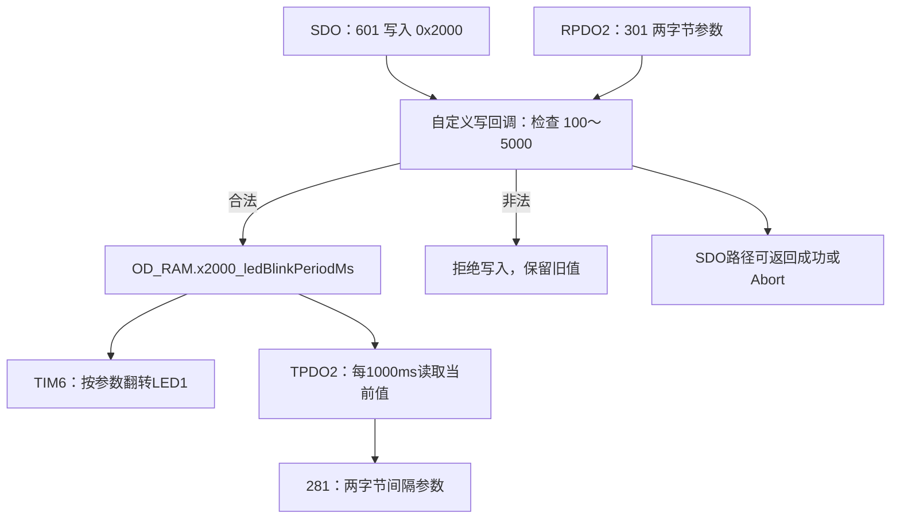

# CANopenNode 学习记录：2026-10-15

> 日期：2026 年 10 月 15 日，Asia/Shanghai。
>
> 今日主题：用 CANopenEditor 正式维护对象字典，将 CANopen 参数与 LED 控制连接起来，并实现 SDO 范围校验、RPDO2 下发参数、TPDO2 周期上报。
>
> 本文根据今天的教学对话、你的验证反馈和当前本地源码整理。报文示例用于复现与解读；硬件效果由你操作确认，整理文档时没有重新发送 CAN 报文。
>
> 前序笔记：[2026-10-11 至 2026-10-13：基础 CAN、移植、NMT、SDO、PDO、SYNC、EMCY](CANopenNode学习记录_2026-10-11至2026-10-13.md)。

## 目录

- [1. 今天完成的功能](#1-今天完成的功能)
- [2. 实验环境与最终配置](#2-实验环境与最终配置)
- [3. 先修复初始化函数的返回值](#3-先修复初始化函数的返回值)
- [4. 在 Ubuntu 中运行 CANopenEditor](#4-在-ubuntu-中运行-canopeneditor)
- [5. 找到与当前工程配套的字典源文件](#5-找到与当前工程配套的字典源文件)
- [6. 新增 LED 参数对象 0x2000](#6-新增-led-参数对象-0x2000)
- [7. 保存项目与导出 C 文件](#7-保存项目与导出-c-文件)
- [8. 查看初值并将新字典接入编译](#8-查看初值并将新字典接入编译)
- [9. 先用 SDO 验证新对象的读写](#9-先用-sdo-验证新对象的读写)
- [10. 让 TIM6 使用对象字典参数控制 LED](#10-让-tim6-使用对象字典参数控制-led)
- [11. 增加对象字典写入校验](#11-增加对象字典写入校验)
- [12. 用 SDO 验证合法与非法写入](#12-用-sdo-验证合法与非法写入)
- [13. 配置 RPDO2 下发 LED 间隔](#13-配置-rpdo2-下发-led-间隔)
- [14. 配置 TPDO2 周期上报 LED 间隔](#14-配置-tpdo2-周期上报-led-间隔)
- [15. 三条访问路径如何连接](#15-三条访问路径如何连接)
- [16. 今天遇到的问题与易错点](#16-今天遇到的问题与易错点)
- [17. 从当前工程重新验证完整功能](#17-从当前工程重新验证完整功能)
- [18. 命令与字节序速查](#18-命令与字节序速查)
- [19. 当前文件分工与源码阅读入口](#19-当前文件分工与源码阅读入口)
- [20. 复习题与后续方向](#20-复习题与后续方向)

## 1. 今天完成的功能

前面已经验证 CANopen 的各类通信服务。今天开始把它们用于一个真正的应用功能：调整 LED1 的翻转间隔。

今日完成顺序：

| 阶段 | 操作 | 验证结果 |
|---|---|---|
| 初始化修正 | 补齐 `canopen_app_init()` 的返回值 | 你修改完成并继续学习 |
| 编辑器环境 | Ubuntu 安装 Mono，运行 CANopenEditor v4.2.3 | 编辑器成功打开 |
| 字典维护 | 复制配套 XPD，新增 `0x2000` | 项目成功保存、导出 |
| 新对象访问 | 更新工程的 OD.c/OD.h，SDO 读写 `0x2000` | 数值读写符合预期 |
| 应用连接 | TIM6 读取 `0x2000` 控制 LED1 | 完成接入，随后继续进行范围校验实验 |
| 写入校验 | 自定义 OD 写函数，限定 100～5000 ms | 你确认功能和预期一致 |
| RPDO2 | 将 `0x301` 的两字节数据映射到 `0x2000:00` | 完成配置，随后继续 TPDO2 实验 |
| TPDO2 | 使用 `0x281` 每秒上报当前间隔 | 你确认和预期一致，要求记录到 docs |

今天形成的功能链路：

```text
上位机通过 SDO 或 RPDO2 写 LED 间隔
                  ↓
          对象字典写入回调校验
                  ↓
        合法：更新 0x2000:00
        非法：保留之前的值
                  ↓
      TIM6 按当前值翻转 LED1
                  ↓
      TPDO2 周期上报当前参数
```

TPDO2 上报的是当前接受的间隔设置值。今天没有新增“读取 GPIO 电平”或“测量实际闪烁频率”的对象。

## 2. 实验环境与最终配置

### 2.1 使用的环境

| 项目 | 当前内容 |
|---|---|
| 主机 | Ubuntu 24.04 系列 |
| 图形监视工具 | CANgaroo |
| CAN 接口 | SocketCAN `can1` |
| 命令行发帧工具 | `cansend` |
| MCU | STM32G474 |
| CAN 外设 | FDCAN2 |
| 帧格式 | Classical CAN，11 位标准 ID |
| 波特率 | 1 Mbit/s |
| 定时器 | TIM6，每 1 ms 中断一次 |
| CANopen Node-ID | 1 |
| 编辑器 | CANopenEditor v4.2.3 |
| 编辑器运行方式 | Mono 运行 `net481/EDSEditor.exe` |
| 当前 Mono | 6.8.0.105 |
| 工程目录 | `/home/c/develop/project/study-canopen/can-bak` |
| 编辑器目录 | `/home/c/develop/tools/CANopenEditor-v4.2.3` |

本地编辑器版本文件为 `v4.2.3-0-gc1071ab`。

### 2.2 今日新增应用对象

| 项目 | 最终设置 |
|---|---|
| 对象地址 | `0x2000:00` |
| 名称 | `ledBlinkPeriodMs` |
| 类型 | `UNSIGNED16`，对应 `uint16_t` |
| 长度 | 2 字节 |
| 单位 | ms，由应用约定 |
| 默认值 | 1000 |
| 合法范围 | 100～5000，包含两端 |
| 存储组 | RAM |
| SDO 权限 | 可读、可写 |
| PDO 权限 | 允许 RPDO 和 TPDO 映射 |
| 应用效果 | 控制 LED1 每次电平翻转的间隔 |

### 2.3 当前主要报文

| ID | DLC | 用途 |
|---|---:|---|
| `000` | 2 | NMT 命令 |
| `080` | 当前配置为 0 | 前序学习中的 SYNC |
| `081` | 8 | 节点 1 EMCY |
| `181` | 4 | TPDO1，上报前序对象 `0x6000:00` |
| `201` | 4 | RPDO1，写入前序对象 `0x6000:00` |
| `281` | 2 | 今日 TPDO2，上报 LED 间隔 |
| `301` | 2 | 今日 RPDO2，下发 LED 间隔 |
| `581` | 8 | 节点 1 SDO 响应 |
| `601` | 8 | 节点 1 SDO 请求 |
| `701` | 1 | 节点 1 Boot-up / 心跳 |

表中 ID 和报文数据均按十六进制阅读。代码里的 `500`、`1000`、`254` 等无前缀整数则是十进制。

## 3. 先修复初始化函数的返回值

前一份笔记已经指出：`canopen_app_init()` 的返回类型是 `int`，但成功路径没有可靠返回初始化结果。

原来的末尾：

```c
canopen_app_resetCommunication();
// return 0;
```

今天你将其改为：

```c
return canopen_app_resetCommunication();
```

位置：

```text
ThirdParty/CANopenNode_STM32/CO_app_STM32.c
canopen_app_init() 末尾
```

原因是主函数会检查：

```c
int init_result = canopen_app_init(&canopenConfig);

if (init_result != 0)
{
    Error_Handler();
}
```

只有下层函数把结果正确返回，上层判断才有依据。

这里返回通信初始化函数的结果，也比不管内部结果统一返回 0 更完整。

这项是对前序笔记第 25.1 节“待完善项”的实际修正。整理今日记录时，已从本地源码确认修改存在。

## 4. 在 Ubuntu 中运行 CANopenEditor

### 4.1 为什么需要编辑器

之前为了理解 PDO 权限，你曾手动修改 `OD.c`。

但这两个文件是生成文件：

```text
OD.h
OD.c
```

如果只有生成文件，没有同步维护字典源文件，下一次导出时就可能把手动修改覆盖掉。

今天学习的正式维护路径：

```text
在 CANopenEditor 中维护 .xpd
             ↓
       导出 OD.h / OD.c
             ↓
    将导出结果接入 STM32 工程
             ↓
         编译、烧录、验证
```

### 4.2 Ubuntu 安装运行环境

今天使用的安装步骤：

```bash
sudo apt update
sudo apt install mono-complete libgdiplus unzip wget
```

各工具作用：

| 工具 | 作用 |
|---|---|
| `mono-complete` | 提供 Mono 运行环境和相关库 |
| `libgdiplus` | 提供图形绘制支持 |
| `wget` | 下载发布包 |
| `unzip` | 解压 ZIP 文件 |

编辑器包含 Windows Forms 图形界面。今天采用 Mono 兼容运行 `net481` 版本，并实际成功打开。

### 4.3 下载和解压发布包

工具放在工程外的独立目录：

```bash
mkdir -p /home/c/develop/tools/CANopenEditor-v4.2.3
cd /home/c/develop/tools/CANopenEditor-v4.2.3
```

下载：

```bash
wget https://github.com/CANopenNode/CANopenEditor/releases/download/v4.2.3/CANopenEditor-v4.2.3-binary.zip
```

解压：

```bash
unzip CANopenEditor-v4.2.3-binary.zip
```

发布包中同时存在 `net481` 和 `net8.0-windows` 目录，本次实际运行的是前者。

### 4.4 解压时为什么提示覆盖 DLL

你遇到了：

```text
replace net481/libEDSsharp.pdb?
[y]es, [n]o, [A]ll, [N]one, [r]ename:
```

这不是编译错误，也不是 CANopen 故障，而是解压工具遇到了同名目标文件。

当时只读检查发布包后发现：

- `net481/Google.Protobuf.dll` 在 ZIP 中出现两次。
- `net481/libEDSsharp.dll` 在 ZIP 中出现两次。
- `net481/libEDSsharp.pdb` 也重复出现。
- 检查的两种 DLL 重复条目 CRC 一致。

因此按照指导，在这次已确认的发布包覆盖提示中输入大写：

```text
A
```

表示后续同名文件全部覆盖，继续完成解压。

你看到的：

```text
inflating: ...
```

表示正在解压，不是报错。

### 4.5 启动编辑器

```bash
cd /home/c/develop/tools/CANopenEditor-v4.2.3/net481
mono EDSEditor.exe
```

今天你确认编辑器已经打开。

正常启动编辑器不需要 `sudo`。

## 5. 找到与当前工程配套的字典源文件

### 5.1 今天选择的来源

使用下载的 STM32 移植仓库中的：

```text
/home/c/develop/project/study-canopen/CANopenSTM32/examples/general/DS301_profile.xpd
```

复制到自己的应用目录：

```bash
cd /home/c/develop/project/study-canopen/can-bak
cp ../CANopenSTM32/examples/general/DS301_profile.xpd App/CANopen/study-canopen.xpd
```

然后在编辑器中：

```text
File → Open
```

打开：

```text
/home/c/develop/project/study-canopen/can-bak/App/CANopen/study-canopen.xpd
```

### 5.2 为什么选 general 目录下的版本

核对来源时发现：

- `examples/general/OD.h` 与之前工程内的 `OD.h` 相同。
- 之前工程的 `OD.c` 相对 general 配套文件，主要多了你手动添加的 `0x6000` TPDO 权限。
- 配套 XPD 已包含 `0x6000`。
- `0x1017` 默认值为 1000。
- 有 4 路有效 RPDO 和 4 路有效 TPDO。

因此这份文件适合作为当前应用的维护起点。

### 5.3 为什么不直接选协议栈 example 模板

另一个同名文件位于：

```text
ThirdParty/CANopenNode/example/DS301_profile.xpd
```

它是通用模板，与本项目当时使用的字典不同：

- 没有当前练习的 `0x6000` 业务对象。
- 心跳周期默认值为 0。

如果直接拿它生成并覆盖 App 中的文件，就可能丢失现有业务对象并改变心跳配置。

**同名 XPD 不代表内容相同。** 复现时要根据完整路径选择。

### 5.4 当前字典源文件也应纳入维护

今天新建的：

```text
App/CANopen/study-canopen.xpd
```

包含对象类型、默认值、访问权限、PDO 映射和通信参数，是应用维护的重要源文件。

只提交 OD.c/OD.h 而不保存对应 XPD，后续仍容易出现“代码改对了，重新导出又丢了”的问题。

## 6. 新增 LED 参数对象 0x2000

### 6.1 为什么选 0x2000

`0x2000～0x5FFF` 属于制造商自定义对象范围。LED 间隔是本应用自己的参数，所以选择 `0x2000`。

地址写作：

```text
0x2000:00
   │    └─ 子索引 0
   └────── 对象索引
```

对象索引 `0x2000` 不是 CAN 报文 ID。后面传这个参数的 RPDO2 ID 是 `0x301`，两者属于不同概念。

### 6.2 编辑器操作

在：

```text
Manufacturer Specific Parameters
```

区域右键，选择：

```text
Add...
```

新增对象索引 `0x2000`。

初次设置：

| 字段 | 初次填写 |
|---|---|
| Index | `0x2000` |
| Name | `ledBlinkPeriodMs` |
| Object Type | `VAR` |
| Data Type | `UNSIGNED16` |
| Access SDO | `rw` |
| Access PDO | `no` |
| Storage Group | `RAM` |
| Default value | `1000` |
| LowLimit | `100` |
| HighLimit | `5000` |
| Enabled | 勾选 |

修改后先点击属性区域的 `Save Changes`，再通过 `File → Save` 保存项目。

### 6.3 各字段意味着什么

- `VAR`：一个普通变量，访问时使用子索引 0。
- `UNSIGNED16`：无符号 16 位整数，对应 C 中的 `uint16_t`。
- `rw`：允许 SDO 读和写。
- `RAM`：运行时数据放在 RAM 中。
- `Default value`：编译生成文件中的启动初值。
- `LowLimit / HighLimit`：记录设计范围。
- `Enabled`：这个对象要包含在生成的字典里。

本次约定这个对象的数值单位为 ms。这个单位由应用定义，不是因为索引 `0x2000` 自带某个标准单位。

### 6.4 PDO 权限经历了三个阶段

| 学习阶段 | Access PDO | 含义 |
|---|---|---|
| 初次新增，只测 SDO | `no` | 暂不允许 PDO 映射 |
| 增加 RPDO2 | `r` | 允许 RPDO 映射 |
| 增加 TPDO2 | `tr` | 同时允许 TPDO 和 RPDO 映射 |

因此今日最终设置是 `rw / tr`，不是最初的 `rw / no`。

### 6.5 LowLimit 和 HighLimit 不自动变成运行时检查

这是今天的重要知识点。

在本次使用的 V4 导出器中，填写上下限会保存到字典描述文件，但不会自动生成“拒绝越界 SDO 写入”的 C 代码。

默认的 `OD_writeOriginal()` 负责把数据复制到变量，并不自动执行你在编辑器填写的 100～5000 范围判断。

因此后面专门增加了应用写入回调。

## 7. 保存项目与导出 C 文件

### 7.1 确认导出器

准确菜单：

```text
Tools → Preferences
```

在 `Selected exporter` 中选择：

```text
CANOPENNODE_V4
```

点击：

```text
Save and close
```

当前发布包中 V4 导出器枚举值为 0，但平时在界面里按选项名称核对更直观。

### 7.2 先补齐 0x6000 的双向权限

之前手动修改 C 文件，让 `0x6000` 同时支持 RPDO 和 TPDO。

今天将这一点同步回编辑器：

| 对象 | Access SDO | Access PDO |
|---|---|---|
| `0x6000` | `rw` | `tr` |

V4 界面中的 PDO 选项：

| 选项 | 含义 |
|---|---|
| `no` | 不允许 PDO 映射 |
| `t` | 允许 TPDO |
| `r` | 允许 RPDO |
| `tr` | 允许两种 PDO |

生成器可以把双向属性写成：

```c
ODA_TRPDO
```

它等价于：

```c
ODA_RPDO | ODA_TPDO
```

所以不能因为新文件没有把两个宏分别写出来，就认为少了一种权限。

### 7.3 为什么要检查旧 XPD 权限

原 general XPD 的 `0x6000` 使用过 `readWriteOutput` 等旧访问描述。编辑器读入时会按其规则解释 PDO 方向，不能只看 XML 中某一个字符串猜权限。

今天中途检查发现过：生成的 C 已经包含双向权限，但 XPD 还保留旧设置。

后来重新明确设置 `rw / tr` 并保存。本文整理时已核对当前 XPD 和 C 文件中的 `0x6000` 双向属性一致。

### 7.4 导出到独立目录

先建立：

```bash
mkdir -p /home/c/develop/project/study-canopen/can-bak/App/CANopen/generated
```

选择：

```text
File → Export CanOpenNode...
```

保存为：

```text
/home/c/develop/project/study-canopen/can-bak/App/CANopen/generated/OD.h
```

保存一次会生成同基名的两个文件：

```text
OD.h
OD.c
```

当前工程使用 `#include "OD.h"`，因此保留 `OD` 这个基名。

### 7.5 今天遇到的“为什么提示覆盖”

你已经在上方 `Save in` 选择了 `generated`，但下面 `File name` 仍然是：

```text
/home/c/develop/project/study-canopen/can-bak/App/CANopen/study-canopen.xpd
```

绝对路径会优先决定保存目标。因此对话框检查的是已经存在的 XPD 路径，而不是你想要的 `generated/OD.h`。

当时的处理步骤：

1. 取消覆盖提示。
2. 在 `File name` 中按 `Ctrl+A`，清空旧内容。
3. 只填写 `OD.h`。
4. 确认 `Save in` 是 `generated`。
5. 保持类型 `CANopenNode (*.h, *.c)`，再保存。

以后重新导出时，如果确认目标正是已有的：

```text
App/CANopen/generated/OD.h
```

提示覆盖就属于正常的重新生成。

判断依据应是完整目标路径和文件名，不能只看上面选择了哪个目录。

## 8. 查看初值并将新字典接入编译

### 8.1 你问过：两个 1000 在哪里看

查看导出的 `generated/OD.c`，也可以查看复制后工程实际使用的 `App/CANopen/OD.c`。

LED 参数：

```c
.x2000_ledBlinkPeriodMs = 0x03E8,
```

心跳周期：

```c
.x1017_producerHeartbeatTime = 0x03E8,
```

换算：

```text
0x03E8 = 1000
```

两者虽然当前都是 1000，但控制不同事情：

| 参数 | 作用 |
|---|---|
| `0x1017` | 心跳生产者周期，单位 ms |
| `0x2000` | 本应用 LED 翻转间隔，约定单位 ms |

在编辑器中也可以分别选中对象，查看 `Default value`。

### 8.2 新对象在 C 文件中的几层结构

`OD.h` 声明类型和数据成员：

```c
uint16_t x2000_ledBlinkPeriodMs;
```

`OD.c` 为变量设置初值：

```c
OD_ATTR_RAM OD_RAM_t OD_RAM = {
    /* 其他成员 */
    .x2000_ledBlinkPeriodMs = 0x03E8,
    .x6000_velocity = 0x00000000
};
```

今日最终的访问描述符：

```c
.o_2000_ledBlinkPeriodMs = {
    .dataOrig = &OD_RAM.x2000_ledBlinkPeriodMs,
    .attribute = ODA_SDO_RW | ODA_TRPDO | ODA_MB,
    .dataLength = 2
},
```

索引表：

```c
{0x2000, 0x01, ODT_VAR, &ODObjs.o_2000_ledBlinkPeriodMs, NULL},
```

这几层连接起来，协议栈才能根据 `0x2000:00` 找到实际变量及访问属性。

### 8.3 两个生成文件必须配套更新

在工程目录执行：

```bash
cd /home/c/develop/project/study-canopen/can-bak
cp App/CANopen/generated/OD.h App/CANopen/OD.h
cp App/CANopen/generated/OD.c App/CANopen/OD.c
```

头文件改变了结构成员，源文件改变了数据初始化和索引表，因此应同时更新。

当前 CMake 使用：

```cmake
"${CANOPEN_APP_DIR}/OD.c"
```

而 `CANOPEN_APP_DIR` 指向：

```text
App/CANopen
```

所以现阶段实际编译的是 `App/CANopen/OD.c`。`generated` 是导出检查目录，不需要再把里面的同名 `OD.c` 加入编译。

### 8.4 今天比较到的主要差异

第一次接入新字典时，主要差异包括：

- 新增 `x2000_ledBlinkPeriodMs` 数据成员。
- 新增相应描述符和索引条目。
- `0x6000` 的双向属性使用等价宏 `ODA_TRPDO`。
- `0x6000` 的索引表数组位置后移。
- 编辑器版本、项目名、日期和部分换行格式变化。

索引表位置变化不代表 CANopen 索引变化。通过 `OD_ENTRY_H6000` 这类生成宏访问，可以随生成结果自动更新位置。

编译和烧录后，你确认新对象 SDO 读写与预期一致。

## 9. 先用 SDO 验证新对象的读写

这时先验证“新对象已经进入固件”，还没有让 LED 代码使用它。

### 9.1 读取默认值

```bash
cansend can1 601#4000200000000000
```

数据拆分：

```text
40 | 00 20 | 00 | 00 00 00 00
读 | 0x2000 | 子0 | 填充
```

预期响应：

```text
581：4B 00 20 00 E8 03 00 00
```

| 字段 | 意义 |
|---|---|
| `4B` | 快速读取成功，返回 2 字节 |
| `00 20` | 索引 `0x2000` |
| `00` | 子索引 0 |
| `E8 03` | 数值 `0x03E8 = 1000` |
| 最后的 `00 00` | 填充 |

### 9.2 写入 500

```bash
cansend can1 601#2B002000F4010000
```

含义：

```text
2B | 00 20 | 00 | F4 01 | 00 00
写2字节 | 2000 | 子0 | 500 | 填充
```

预期成功响应：

```text
581：60 00 20 00 00 00 00 00
```

再次读取：

```bash
cansend can1 601#4000200000000000
```

预期：

```text
581：4B 00 20 00 F4 01 00 00
```

你确认结果和预期一样。

### 9.3 为什么这一阶段 LED 还不会改变

对象字典变量被写入，并不自动改变 GPIO 行为。

只有应用代码读取这个变量，并把它用于计时或控制，通信参数才会产生实际应用效果。

因此下一步修改了 TIM6 回调。

## 10. 让 TIM6 使用对象字典参数控制 LED

### 10.1 修改位置

文件：

```text
Core/Src/stm32g4xx_it.c
```

在 `USER CODE BEGIN Includes` 区域加入：

```c
#include "OD.h"
```

然后修改已经存在的 `HAL_TIM_PeriodElapsedCallback()`。

### 10.2 当前回调代码

```c
void HAL_TIM_PeriodElapsedCallback(TIM_HandleTypeDef *htim)
{
    if (htim->Instance == TIM6)
    {
        canopen_app_interrupt();

        static uint16_t count = 0;

        /* 从对象字典读取 LED 翻转间隔，单位 ms */
        uint16_t period_ms = OD_RAM.x2000_ledBlinkPeriodMs;

        /* 使用值超出设计范围时，暂时按 1000 ms 工作 */
        if (period_ms < 100U || period_ms > 5000U)
        {
            period_ms = 1000U;
        }

        if (++count >= period_ms)
        {
            count = 0;
            HAL_GPIO_TogglePin(LED1_GPIO_Port, LED1_Pin);
        }
    }
}
```

### 10.3 为什么累计次数就是毫秒数

TIM6 每 1 ms 进入一次回调：

```text
累计 500 次  = 500 ms
累计 1000 次 = 1000 ms
累计 2000 次 = 2000 ms
```

原来使用常量：

```c
if (++count >= 1000)
```

现在使用参数：

```c
if (++count >= period_ms)
```

### 10.4 翻转间隔和完整亮灭周期不同

| 参数值 | 翻转一次 | 完整亮灭周期约为 |
|---:|---:|---:|
| 500 | 0.5 秒 | 1 秒 |
| 1000 | 1 秒 | 2 秒 |
| 2000 | 2 秒 | 4 秒 |

因为一次 Toggle 只是从亮变灭，或者从灭变亮；恢复到同一状态需要两次翻转。

参数变化时当前 `count` 没有清零，所以第一次翻转的等待时间可能不完整，随后按新间隔稳定运行。

### 10.5 初步验证命令

设置 500 ms：

```bash
cansend can1 601#2B002000F4010000
```

设置 2000 ms：

```bash
cansend can1 601#2B002000D0070000
```

恢复 1000 ms：

```bash
cansend can1 601#2B002000E8030000
```

### 10.6 定时器里的保护不等于拒绝写入

回调中的：

```c
if (period_ms < 100U || period_ms > 5000U)
{
    period_ms = 1000U;
}
```

只改变本次应用使用的局部变量。

它不把 OD 中的非法值改回 1000，也不让 SDO 返回错误。所以今天继续增加了真正的写入校验。

## 11. 增加对象字典写入校验

目标：

> `0x2000` 只接受 100～5000；非法写入被拒绝，变量保留之前的合法值。

### 11.1 业务规则放在哪里

规则写在：

```text
Core/Src/main.c
USER CODE BEGIN 0 区域
```

这样重新生成 OD 文件时，可以保留应用校验代码。

今天没有把范围判断手动塞进生成的 `OD.c` 中。

### 11.2 当前自定义写函数

```c
static ODR_t OD_write_ledBlinkPeriodMs(
    OD_stream_t *stream,
    const void *buf,
    OD_size_t count,
    OD_size_t *countWritten)
{
    if (stream == NULL || buf == NULL || countWritten == NULL)
    {
        return ODR_DEV_INCOMPAT;
    }

    *countWritten = 0;

    if (stream->subIndex != 0U)
    {
        return ODR_SUB_NOT_EXIST;
    }

    if (count != sizeof(uint16_t))
    {
        return ODR_TYPE_MISMATCH;
    }

    /* buf 指向本次要写入的对象数据 */
    uint16_t value = CO_getUint16(buf);

    if (value < 100U)
    {
        return ODR_VALUE_LOW;
    }

    if (value > 5000U)
    {
        return ODR_VALUE_HIGH;
    }

    /* 校验通过，才真正更新对象字典变量 */
    return OD_writeOriginal(stream, buf, count, countWritten);
}
```

### 11.3 四个参数怎么理解

| 参数 | 意义 |
|---|---|
| `stream` | 当前访问的 OD 对象信息，包括子索引、长度、原始地址等 |
| `buf` | 本次要写入的数据 |
| `count` | 本次提供的数据字节数 |
| `countWritten` | 函数实际写入了多少字节，通过指针返回 |

对于写入 500，`buf` 对应：

```text
F4 01
```

不是整帧：

```text
2B 00 20 00 F4 01 00 00
```

SDO 解析索引、命令和数据长度后，才调用对象的写接口。

### 11.4 为什么先校验，再调用 OD_writeOriginal

执行顺序：

```text
检查指针、子索引和长度
        ↓
读取准备写入的数值
        ↓
检查范围
    ├─ 小于100 → 返回 ODR_VALUE_LOW
    ├─ 大于5000 → 返回 ODR_VALUE_HIGH
    └─ 合法 → 调用 OD_writeOriginal
```

非法分支没有执行原始写入，所以旧值保留。

若先写变量再返回错误，就会出现“上位机以为失败，但变量已经改变”的错误行为。

### 11.5 定义扩展结构

同样位于 `main.c` 的用户代码区：

```c
static OD_extension_t ledBlinkExtension = {
    .object = NULL,
    .read = OD_readOriginal,
    .write = OD_write_ledBlinkPeriodMs
};
```

| 字段 | 作用 |
|---|---|
| `object` | 本次没有额外的应用上下文，因此为 NULL |
| `read` | 保留原始读取功能 |
| `write` | 使用自定义写入校验 |

`read` 不能随意设为 NULL。在这个扩展接口中，NULL 会使扩展读取被禁用，进而影响 SDO 读取和后面 TPDO 的数据访问。

结构使用 `static`，因为协议栈保存的是它的指针，后续通信时还要访问。不能把它放进一个返回后就失效的普通局部对象里。

### 11.6 注册顺序

在 `canopen_app_init()` 之前：

```c
if (OD_extension_init(OD_ENTRY_H2000_ledBlinkPeriodMs,
                      &ledBlinkExtension) != ODR_OK)
{
    Error_Handler();
}

int init_result = canopen_app_init(&canopenConfig);

if (init_result != 0)
{
    Error_Handler();
}
```

本地 `OD_extension_init()` 的核心动作是：

```c
entry->extension = extension;
```

它不依赖已经创建的 CANopen 运行对象，所以可以在协议栈初始化前注册。

### 11.7 为什么必须关注 PDO 初始化前后顺序

SDO 新请求会查找对象的访问接口。

PDO 则会在初始化映射时取得并缓存接口：

```text
注册 0x2000 扩展
      ↓
初始化 CANopen
      ↓
初始化 PDO 映射
      ↓
缓存带有校验的 write、正常的 read
```

如果 PDO 已经缓存了旧接口，之后才修改扩展，不能假定已有 PDO 的缓存也会自动替换。

今天把注册放在 `canopen_app_init()` 之前，同时满足 SDO 和后续 PDO 的使用需求。

### 11.8 应用保护的两层含义

| 位置 | 作用 |
|---|---|
| 对象写入回调 | 拒绝经过该接口的非法写入，保留旧值 |
| 定时器读取后的范围保护 | 防止应用使用到不合理的间隔 |

直接在 C 代码中给 `OD_RAM.x2000_ledBlinkPeriodMs` 赋值不会自动经过自定义写回调。因此应用侧保护仍有独立意义。

合法范围包含 100 和 5000。今天重点验证了正常值、过小值和过大值；边界值可作为后续复习补测。

## 12. 用 SDO 验证合法与非法写入

### 12.1 先建立一个合法旧值：500

```bash
cansend can1 601#2B002000F4010000
```

预期：

```text
581：60 00 20 00 00 00 00 00
```

LED 每 500 ms 翻转一次。

### 12.2 写入 50：过小

```bash
cansend can1 601#2B00200032000000
```

`0x0032 = 50`。

预期：

```text
581：80 00 20 00 32 00 09 06
```

| 字段 | 含义 |
|---|---|
| `80` | SDO 中止响应 |
| `00 20 00` | 原请求对象 `0x2000:00` |
| `32 00 09 06` | 小端错误码 `0x06090032`，数值过小 |

### 12.3 写入 6000：过大

```bash
cansend can1 601#2B00200070170000
```

`0x1770 = 6000`，小端数据是 `70 17`。

预期：

```text
581：80 00 20 00 31 00 09 06
```

错误码：

```text
0x06090031：数值过大
```

### 12.4 为什么不用自己组装 80 响应

自定义回调只返回：

```c
ODR_VALUE_LOW
ODR_VALUE_HIGH
```

SDO 服务器把 OD 返回值转换成相应的 SDO Abort Code，再组织 `581` 中止报文。

当前代码路径：

```text
CO_SDOserver_process()
  → 调用扩展 write
  → 收到 ODR_VALUE_LOW / HIGH
  → OD_getSDOabCode()
  → 组织 SDO Abort
  → 发送 581
```

应用不需要在写回调中直接调用 HAL 发一帧 `581`。

### 12.5 读回确认旧值仍在

```bash
cansend can1 601#4000200000000000
```

预期仍为 500：

```text
581：4B 00 20 00 F4 01 00 00
```

你确认这项功能和预期一致。

## 13. 配置 RPDO2 下发 LED 间隔

### 13.1 为什么用第二路

前序练习已经使用：

```text
RPDO1，ID 201 → 0x6000:00，4字节
```

今天另用：

```text
RPDO2，ID 301 → 0x2000:00，2字节
```

RPDO 中不再携带 SDO 命令、索引和子索引；报文内容由事先配置的映射约定。

### 13.2 修改应用对象权限

选中 `0x2000`：

| 字段 | RPDO2 阶段的值 |
|---|---|
| Access SDO | `rw` |
| Access PDO | `r` |

同时核对 `0x6000` 为 `rw / tr`。

最终 TPDO2 阶段又把 `0x2000` 改成了 `tr`，见下一节。

### 13.3 在编辑器设置启动默认值

修改的是 `Default value`：

| 地址 | 含义 | 设置 |
|---|---|---|
| `0x1401:01` | RPDO2 COB-ID | `0x00000301` |
| `0x1401:02` | 传输类型 | `254` |
| `0x1601:00` | 有效映射数量 | `1` |
| `0x1601:01` | 第一项映射 | `0x20000010` |

相关对象保持 Enabled。

不要把 `0x1601:00` 的有效映射数，与 `0x1401:00` 的最高子索引混淆。

当前字典已有 4 路 RPDO，因此是在配置第二路，不需要再新增一组对象或修改 RPDO 总数。

### 13.4 理解 0x20000010

```text
0x2000 00 10
   │   │  └─ 0x10 = 16 bit = 2字节
   │   └──── 子索引00
   └──────── 对象索引2000
```

这里低八位是位数，不是字节数。不能把 2 字节直接写成映射长度 `02`。

### 13.5 当前生成的关键配置

```c
.x1401_RPDOCommunicationParameter = {
    .highestSub_indexSupported = 0x05,
    .COB_IDUsedByRPDO = 0x00000301,
    .transmissionType = 0xFE,
    .eventTimer = 0x0000
},

.x1601_RPDOMappingParameter = {
    .numberOfMappedApplicationObjectsInPDO = 0x01,
    .applicationObject1 = 0x20000010,
    /* 其余映射项为0 */
},
```

COB-ID 的 bit31 为 0，表示这路 PDO 启用。

节点编号为 1 时，默认 RPDO2 ID 为 `0x300 + 1 = 0x301`。本次明确配置了 `301`，不会再叠加一次变成 `302`。

### 13.6 为什么这次不用运行时清空映射

今天通过编辑器修改默认值，再生成文件、编译和启动。

协议栈初始化时看到的已经是一整套配置，所以不需要在总线上先发送“禁用 PDO、清空映射数”的 SDO 命令。

如果在设备运行期间用 SDO 重映射，仍需要遵循前序学习的配置顺序。

### 13.7 导出和烧录

完成每个对象修改后保存对象，再保存整个 XPD。

重新导出到 `generated/OD.h`，检查后复制两份文件到 App 根目录，再编译和烧录。

今天 RPDO2 和 TPDO2 的默认值都保存在 XPD 中。`main.c` 没有再次覆盖这两路参数。

### 13.8 RPDO2 合法值验证

写入 500：

```bash
cansend can1 301#F401
```

写入 2000：

```bash
cansend can1 301#D007
```

两个命令都是：

```text
ID：301
DLC：2
```

例如 `F4 01` 直接表示 500，不需要再添加 `2B 00 20 00`。

发送 2000 后，通过 SDO 读回：

```bash
cansend can1 601#4000200000000000
```

预期：

```text
581：4B 00 20 00 D0 07 00 00
```

### 13.9 RPDO 也使用已有校验

发送 50：

```bash
cansend can1 301#3200
```

发送 6000：

```bash
cansend can1 301#7017
```

两者都超出范围。当前扩展在原始写入前返回错误，因此变量应继续保持此前的 2000，LED 仍按 2 秒翻转。

### 13.10 为什么不会收到 SDO 的 80 响应

RPDO 不是 SDO 请求，没有 SDO 的逐次响应机制。

当前 `CO_RPDO_process()` 调用映射对象的写接口，但没有把其返回值转换成 SDO 中止报文。

所以：

- 校验函数确实可以阻止变量更新。
- 不应等待 `581/80` 作为这个 RPDO 的回复。
- 本回调没有主动报告 EMCY，也不应期待越界一定产生 `081`。
- 用 SDO 读回或 TPDO2 上报值，确认参数是否被接受。

RPDO 的 CAN 链路层 ACK 与这里的应用参数是否接受，也不是同一层确认。

## 14. 配置 TPDO2 周期上报 LED 间隔

### 14.1 目标

通过：

```text
ID：281
DLC：2
```

每 1000 ms 上报当前 `0x2000:00`。

你最后确认整体工作和预期一致。

### 14.2 将 0x2000 权限改为双向

| 字段 | 最终值 |
|---|---|
| Access SDO | `rw` |
| Access PDO | `tr` |

导出的属性：

```c
.attribute = ODA_SDO_RW | ODA_TRPDO | ODA_MB,
.dataLength = 2
```

原写回调继续负责 SDO/RPDO 写入校验；扩展中的 `read = OD_readOriginal` 为 SDO 和 TPDO 提供读取接口。

### 14.3 TPDO2 的编辑器配置

修改 Default value：

| 地址 | 含义 | 设置 |
|---|---|---|
| `0x1801:01` | TPDO2 COB-ID | `0x40000281` |
| `0x1801:02` | 传输类型 | `254` |
| `0x1801:03` | 抑制时间 | `0` |
| `0x1801:05` | 事件定时器 | `1000` |
| `0x1A01:00` | 有效映射数量 | `1` |
| `0x1A01:01` | 第一项映射 | `0x20000010` |

注意数字：

- `1800 / 1A00` 是第一路 TPDO。
- `1801 / 1A01` 是第二路 TPDO。
- 第二路实际发送 ID 是 `281`，不是对象索引 `1801`。

### 14.4 当前生成的关键配置

```c
.x1801_TPDOCommunicationParameter = {
    .highestSub_indexSupported = 0x06,
    .COB_IDUsedByTPDO = 0x40000281,
    .transmissionType = 0xFE,
    .inhibitTime = 0x0000,
    .eventTimer = 0x03E8,
    .SYNCStartValue = 0x00
},

.x1A01_TPDOMappingParameter = {
    .numberOfMappedApplicationObjectsInPDO = 0x01,
    .applicationObject1 = 0x20000010,
    /* 其余映射项为0 */
},
```

`0x40000281`：

| 部分 | 意义 |
|---|---|
| bit31 = 0 | 启用 TPDO |
| bit30 = 1 | 禁止 RTR 请求 |
| 低 11 位 `281` | 实际标准 CAN-ID |

`eventTimer = 0x03E8` 即 1000 ms。

### 14.5 默认上报

编译、烧录，节点运行后观察：

```text
ID：281
DLC：2
数据：E8 03
```

表示当前默认参数为 1000 ms。

稳定发送间隔约 1 秒。首帧可能在进入运行状态后很快发送，不保证一定先等待完整 1 秒。

### 14.6 写入 500 后观察上报

```bash
cansend can1 301#F401
```

预期：

- LED 每 500 ms 翻转。
- 后续 `281` 内容为 `F4 01`。
- `281` 稳定发送间隔仍约 1000 ms。

### 14.7 LED 间隔和 TPDO 周期是两个参数

| 内容 | 控制对象 | 当前示例 |
|---|---|---|
| LED 翻转间隔 | `0x2000:00` | 500 ms |
| TPDO2 上报周期 | `0x1801:05` | 1000 ms |
| 心跳周期 | `0x1017:00` | 1000 ms |

后三者即使有时数值相同，也不是同一个计时器或同一个功能。

TPDO2 报文内容是设置值。它不是每次 LED 翻转都必须发一帧，也不是 RPDO2 的立即回复。

### 14.8 非法值验证

在已接受 500 的前提下发送：

```bash
cansend can1 301#7017
```

6000 被拒绝，预期：

```text
LED：继续按500ms翻转
281：继续上报 F4 01
```

你确认结果符合预期。

## 15. 三条访问路径如何连接

### 15.1 SDO 写入路径

```text
601：写0x2000
  → CAN接收中断缓存请求
  → 主循环 CO_SDOserver_process
  → 获取对象字典扩展
  → OD_write_ledBlinkPeriodMs
      ├─ 合法：OD_writeOriginal
      └─ 非法：返回OD错误码
  → 581：成功或Abort响应
```

这条路径已经在前序课程学习过，今天把自己的应用回调加入了其中。

### 15.2 RPDO2 写入路径

```text
301：两字节参数
  → CAN接收中断
  → CO_PDO_receive缓存数据
  → TIM6中的CO_process_RPDO
  → CO_RPDO_process
  → 已缓存的OD_IO.write
  → OD_write_ledBlinkPeriodMs
      ├─ 合法：更新OD_RAM.x2000_ledBlinkPeriodMs
      └─ 非法：保留旧值
```

由于 RPDO2 类型为 254，本轮不需要发送 SYNC。

### 15.3 LED 应用路径

```text
TIM6每1ms中断
  → canopen_app_interrupt处理协议实时部分
  → 读取OD_RAM.x2000_ledBlinkPeriodMs
  → 范围保护
  → count累计到间隔
  → HAL_GPIO_TogglePin翻转LED1
```

### 15.4 TPDO2 读取路径

```text
TIM6中的CO_process_TPDO
  → CO_TPDO_process
  → 事件定时器到期
  → CO_TPDOsend
  → 已缓存的OD_IO.read
  → OD_readOriginal读取0x2000当前值
  → CO_CANsend
  → HAL发送281
```

当前没有在 LED 参数写入成功后调用 `OD_requestTPDO()`。所以不要把本次上报描述成“每次写入都主动立即上报”。

### 15.5 全部连接关系



图中的 SDO 响应分支只适用于 SDO 访问。RPDO 路径没有对应的 `581` 成功或中止回复。

## 16. 今天遇到的问题与易错点

### 16.1 编辑器打开了，但对象源文件还没准备好

运行工具和打开项目是两个动作。

要打开自己的：

```text
App/CANopen/study-canopen.xpd
```

而不是随便选择编辑器自带模板。

### 16.2 只保存对象，没有保存项目

`Save Changes` 负责把当前属性编辑应用到对象；`File → Save` 负责把项目保存到磁盘。

今天曾经检查到 XPD 与生成的 C 权限不一致，说明不能只凭导出 C 正确就认定项目源文件也已同步。

### 16.3 导出对话框选了目录，但文件名仍是绝对路径

如果下方仍填写旧 XPD 的完整路径，它会优先决定目标。

进入 `generated` 后将文件名明确改为 `OD.h`。

### 16.4 上下限填写了，但非法 SDO 仍能写入

编辑器中的上下限不会自动变成当前 V4 固件的校验函数。

实际拒绝由今天新增的 `OD_write_ledBlinkPeriodMs()` 实现。

### 16.5 只改 C 文件权限，下次导出又退回

应在 XPD 中保存 `rw / tr` 等配置，并检查导出结果。

今日最终 `0x2000` 和 `0x6000` 都是双向 PDO 属性。

### 16.6 把翻转间隔当成完整闪烁周期

500 ms 参数意味着每 500 ms 翻转一次，完整亮灭周期约 1 秒。

### 16.7 把 RPDO2 发成四字节

`0x6000` 是四字节，但今日 `0x2000` 是两字节。

因此：

```text
201：本项目RPDO1为4字节
301：本项目RPDO2为2字节
```

向 `301` 发送多余填充字节可能产生 PDO 长度错误。不要套用前序四字节练习的帧长。

### 16.8 非法 RPDO 没有 80 响应，以为校验失败

RPDO 不使用 SDO 响应协议。

应观察参数是否保持旧值，以及 `281` 上报内容是否保持旧值。

### 16.9 只改 Access PDO，没有注册写扩展

映射权限决定“能不能映射”，扩展决定“访问时执行什么应用逻辑”。

两者需要一起理解。

### 16.10 扩展注册晚于 PDO 初始化

PDO 会缓存读写接口。今天的正确顺序是在 `canopen_app_init()` 之前注册。

### 16.11 编译通过不等于 PDO 映射一定有效

部分 PDO 映射错误可能使该 PDO 被禁用并产生 EMCY，而不一定让整个初始化函数返回失败。

所以还要实际发送 `301`、读取对象并观察 `281`，不能只凭编译成功判断映射已生效。

### 16.12 复位后参数恢复 1000

今天还没有实现参数掉电保存。

重新烧录、节点复位或重新上电会重新建立启动数据，`0x2000` 恢复编译默认值 1000。

XPD 属于开发电脑上的源文件，运行中发 SDO/RPDO 不会反过来自动修改电脑里的 XPD 或固件 Flash。

当前 STM32 适配层还关闭了存储分支，`CO_storageBlank` 本身也没有实际非易失读写。这部分属于后续课程。

## 17. 从当前工程重新验证完整功能

以下步骤用于复习。逐条操作，观察对应 ID；不要把所有命令当成必须一次粘贴的脚本。

### 17.1 检查准备条件

- 当前运行的是包含今日字典和回调的新固件。
- USB-CAN 为 `can1`，波特率为 1 Mbit/s。
- CANgaroo 没有其他周期 `301` 帧持续改写参数。
- 节点处于 Operational。
- 今日 RPDO2、TPDO2 都是类型 254，不需要 SYNC。

### 17.2 重新建立启动状态

如果要从默认值开始，可以复位节点：

```bash
cansend can1 000#8101
```

等待 Boot-up 和运行心跳：

```text
701：00
701：05
```

观察 TPDO2：

```text
281：E8 03
```

### 17.3 读取默认间隔

```bash
cansend can1 601#4000200000000000
```

预期：

```text
581：4B 00 20 00 E8 03 00 00
```

### 17.4 用 SDO 写入 500

```bash
cansend can1 601#2B002000F4010000
```

预期：

```text
581：60 00 20 00 00 00 00 00
后续281：F4 01
LED：每500ms翻转
```

### 17.5 用 SDO 写非法值

过小：

```bash
cansend can1 601#2B00200032000000
```

预期：

```text
581：80 00 20 00 32 00 09 06
```

过大：

```bash
cansend can1 601#2B00200070170000
```

预期：

```text
581：80 00 20 00 31 00 09 06
```

参数和 `281` 仍为 500。

### 17.6 用 RPDO2 写入 2000

```bash
cansend can1 301#D007
```

预期：

```text
后续281：D0 07
LED：每2秒翻转
```

### 17.7 用 RPDO2 写非法值

```bash
cansend can1 301#3200
```

```bash
cansend can1 301#7017
```

再读：

```bash
cansend can1 601#4000200000000000
```

预期：

```text
581：4B 00 20 00 D0 07 00 00
后续281：D0 07
LED：继续每2秒翻转
```

### 17.8 恢复 1000

```bash
cansend can1 301#E803
```

后续 `281` 应为：

```text
E8 03
```

这一套实验同时验证：新对象、SDO、写扩展、RPDO2、LED 应用和 TPDO2。

## 18. 命令与字节序速查

### 18.1 今日数值

| 十进制 | 十六进制 | 两字节小端 |
|---:|---|---|
| 50 | `0x0032` | `32 00` |
| 100 | `0x0064` | `64 00` |
| 500 | `0x01F4` | `F4 01` |
| 1000 | `0x03E8` | `E8 03` |
| 2000 | `0x07D0` | `D0 07` |
| 5000 | `0x1388` | `88 13` |
| 6000 | `0x1770` | `70 17` |

100 和 5000 在这里作为合法边界参考，今天没有单独反馈这两个边界的原始报文日志。

### 18.2 SDO 命令

| 操作 | 命令 |
|---|---|
| 读 LED 间隔 | `cansend can1 601#4000200000000000` |
| 写 500 | `cansend can1 601#2B002000F4010000` |
| 写 1000 | `cansend can1 601#2B002000E8030000` |
| 写 2000 | `cansend can1 601#2B002000D0070000` |
| 写 50，预期拒绝 | `cansend can1 601#2B00200032000000` |
| 写 6000，预期拒绝 | `cansend can1 601#2B00200070170000` |
| 读心跳周期 | `cansend can1 601#4017100000000000` |

### 18.3 RPDO2 命令

| 操作 | 命令 |
|---|---|
| 写 500 | `cansend can1 301#F401` |
| 写 1000 | `cansend can1 301#E803` |
| 写 2000 | `cansend can1 301#D007` |
| 写 50，预期保留旧值 | `cansend can1 301#3200` |
| 写 6000，预期保留旧值 | `cansend can1 301#7017` |

### 18.4 关键区别

```text
SDO写500：
601#2B002000F4010000
包含命令、索引、子索引和数据，DLC8。

RPDO2写500：
301#F401
只包含已映射数据，DLC2。

TPDO2上报500：
281#F401
节点按自己的周期发送当前数据，DLC2。
```

### 18.5 今日最终 PDO 默认配置总表

| 地址 | 含义 | 当前值 |
|---|---|---|
| `0x1401:01` | RPDO2 COB-ID | `0x00000301` |
| `0x1401:02` | RPDO2 类型 | `254` |
| `0x1601:00` | RPDO2 有效映射数 | `1` |
| `0x1601:01` | RPDO2 第一映射 | `0x20000010` |
| `0x1801:01` | TPDO2 COB-ID | `0x40000281` |
| `0x1801:02` | TPDO2 类型 | `254` |
| `0x1801:03` | TPDO2 抑制时间 | `0` |
| `0x1801:05` | TPDO2 事件定时器 | `1000 ms` |
| `0x1A01:00` | TPDO2 有效映射数 | `1` |
| `0x1A01:01` | TPDO2 第一映射 | `0x20000010` |

## 19. 当前文件分工与源码阅读入口

### 19.1 今日应用结构

```text
can-bak/
├── App/
│   └── CANopen/
│       ├── study-canopen.xpd      编辑器维护源文件
│       ├── generated/
│       │   ├── OD.h               导出检查文件
│       │   └── OD.c
│       ├── OD.h                   当前编译使用的头文件
│       └── OD.c                   当前编译使用的字典实现
├── Core/Src/
│   ├── main.c                     写扩展、扩展注册、协议初始化
│   └── stm32g4xx_it.c              TIM6处理、LED应用
├── ThirdParty/
│   ├── CANopenNode/
│   └── CANopenNode_STM32/
│       └── CO_app_STM32.c          已补齐初始化返回值
└── docs/
    ├── CANopenNode学习记录_2026-10-11至2026-10-13.md
    └── CANopenNode学习记录_2026-10-15.md
```

### 19.2 定位表

下面的链接相对本文所在的 docs 目录。行号是本次整理时的参考，之后可按函数名搜索。

| 文件 | 内容 | 当前定位 |
|---|---|---|
| [study-canopen.xpd](../App/CANopen/study-canopen.xpd) | 今日正式字典定义 | `2000`、`1401/1601`、`1801/1A01` |
| [OD.h](../App/CANopen/OD.h) | 新变量类型和入口宏 | 第 245、341 行 |
| [OD.c](../App/CANopen/OD.c) | 心跳和 LED 初值 | 第 33、205 行 |
| [OD.c](../App/CANopen/OD.c) | RPDO2 配置 | 第 54、83 行 |
| [OD.c](../App/CANopen/OD.c) | TPDO2 配置 | 第 124、159 行 |
| [OD.c](../App/CANopen/OD.c) | 新对象访问描述符 | 第 1117 行 |
| [main.c](../Core/Src/main.c) | 自定义写函数 | 第 62 行 |
| [main.c](../Core/Src/main.c) | 扩展结构 | 第 102 行 |
| [main.c](../Core/Src/main.c) | 初始化前注册扩展 | 第 180 行 |
| [stm32g4xx_it.c](../Core/Src/stm32g4xx_it.c) | TIM6 回调及 LED 计时 | 第 248 行 |
| [CO_app_STM32.c](../ThirdParty/CANopenNode_STM32/CO_app_STM32.c) | 初始化返回值修正 | 第 125 行 |
| [CO_ODinterface.h](../ThirdParty/CANopenNode/301/CO_ODinterface.h) | 扩展结构、OD返回值、注册函数 | `OD_extension_t`、`OD_extension_init()` |
| [CO_ODinterface.c](../ThirdParty/CANopenNode/301/CO_ODinterface.c) | 原始读写、扩展选择、错误码转换 | `OD_writeOriginal()`、`OD_getSub()`、`OD_getSDOabCode()` |
| [CO_SDOserver.c](../ThirdParty/CANopenNode/301/CO_SDOserver.c) | 调用写回调并生成 Abort | `CO_SDOserver_process()` |
| [CO_PDO.c](../ThirdParty/CANopenNode/301/CO_PDO.c) | 映射缓存、RPDO写入、TPDO读取与计时 | `PDOconfigMap()`、`CO_RPDO_process()`、`CO_TPDO_process()` |

### 19.3 当前参数有两处启动配置来源

| 配置 | 当前主要来源 |
|---|---|
| Node-ID | `main.c` 中的 `desiredNodeID = 1` |
| RPDO1 / TPDO1 | `main.c` 中初始化前的赋值 |
| RPDO2 / TPDO2 | XPD 导出的 `OD.c` 默认值 |
| LED 默认间隔 | XPD 导出的 `OD.c` 初值 |
| 合法范围的实际拒绝逻辑 | `main.c` 的自定义写函数 |
| LED 如何工作 | `stm32g4xx_it.c` 的应用代码 |

后续阅读时，应同时看生成文件和应用是否覆盖参数。

今日没有把前序第一路 PDO 的全部配置迁回编辑器，避免把尚未实施的重构当成已经完成。

### 19.4 学习资料入口

今日实际使用版本：

- [CANopenEditor v4.2.3 发布页](https://github.com/CANopenNode/CANopenEditor/releases/tag/v4.2.3)
- [Mono Windows Forms 说明](https://www.mono-project.com/docs/gui/winforms/)
- [CANopenEditor v4.2.3 导出操作源码](https://github.com/CANopenNode/CANopenEditor/blob/v4.2.3/EDSEditorGUI/Form1.cs)
- [CANopenEditor v4.2.3 V4 导出器](https://github.com/CANopenNode/CANopenEditor/blob/v4.2.3/libEDSsharp/CanOpenNodeExporter_V4.cs)

项目实际行为以本地所用版本和今日核对的源码为准。

## 20. 复习题与后续方向

### 20.1 自测题

1. 为什么今天开始维护 XPD，而不继续只手改 OD.c？
2. 为什么要选择 general 目录下的配套文件？
3. `Save Changes`、`File → Save`、`Export CanOpenNode` 分别做什么？
4. 选了 generated 文件夹，为什么仍可能提示覆盖 XPD？
5. `UNSIGNED16` 对应几字节？映射长度应该写 `10` 还是 `02`？
6. `0x03E8` 为什么是 1000？报文里为什么写成 `E8 03`？
7. 填好 LowLimit 和 HighLimit，为什么还要写回调？
8. 定时器中的局部范围保护，与写入回调拒绝写入有什么不同？
9. 写回调中的 `buf` 是整个 SDO 报文，还是对象数据部分？
10. 为什么合法值要在调用 OD_writeOriginal 之前检查？
11. 为什么扩展结构要一直存在？
12. 为什么注册扩展要早于 PDO 初始化？
13. SDO 写入 6000 为什么收到 `80`，RPDO 写入 6000 为什么没有？
14. `0x1401 / 0x1601` 和 `0x1801 / 0x1A01` 分别属于哪一方向？
15. LED 每 500 ms 翻转时，为什么 `281` 仍可以每 1000 ms 发一次？
16. `281` 上报设置值，能否直接说明当前 GPIO 正在高电平？
17. 复位后为什么间隔恢复 1000？保存 XPD 能否代替 MCU 参数持久化？

答案可以按主题回查：

| 题号 | 章节 |
|---|---|
| 1～2 | 第 5 节 |
| 3～4 | 第 7 节 |
| 5 | 第 6、13 节 |
| 6 | 第 8、9 节 |
| 7 | 第 6、11 节 |
| 8～12 | 第 10、11 节 |
| 13 | 第 12、13 节 |
| 14 | 第 13、14 节 |
| 15～16 | 第 14 节 |
| 17 | 第 16 节 |

### 20.2 当前已经完成和尚未完成的边界

已经完成：

- 对象字典源文件维护及生成流程。
- 单个应用参数的 SDO 访问。
- 应用参数控制 LED。
- 写入范围校验。
- RPDO2 下发。
- TPDO2 周期上报。

尚未实施：

- 参数变化后主动请求 TPDO 立即上报。
- 专门的 LED 电平或测量反馈对象。
- 参数掉电保存和重新加载。
- 将全部第一路 PDO 默认配置迁回 XPD。
- 多应用对象打包映射。
- 心跳消费者和掉线处理等后续功能。

### 20.3 下一阶段可以学习什么

建议沿着当前功能继续：

1. 学习 `OD_requestTPDO()`：合法参数改变后主动申请上报。
2. 配合抑制时间，观察连续写入时的发送行为。
3. 再考虑设计非易失存储，让参数断电后保留。

这些是后续学习方向，本次记录不把它们列为已经完成的实验。

